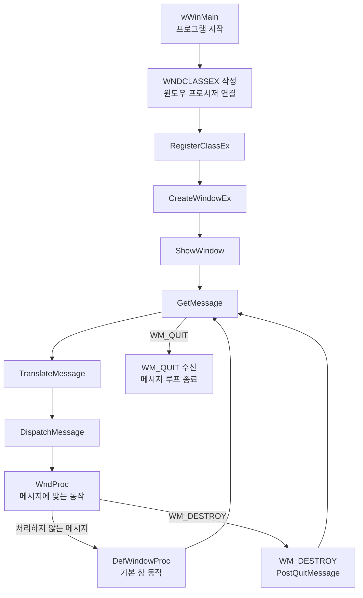

## Win32 학습 커리큘럼
## 👑 시작하기 전에
이 커리큘럼은 C/C++ 언어에 대한 기본적인 이해(포인터, 구조체, 함수 등)가 있다는 것을 전제로 합니다. Win32 API는 C언어 기반으로 설계되었기 때문입니다. Visual Studio 사용법에 익숙하다면 더욱 좋습니다.

이 문서는 주제 지도를 제공합니다. 각 단계는 아래 연결된 예제에서 직접 실행하고, 동작을 조금씩 바꾸어 확인하세요. 전체 작업 목록과 진행 상황은 [학습 자료 개선 계획](../docs/LEARNING_MATERIALS_PLAN.md)에서 확인할 수 있습니다.

| 단계 | 연결된 예제 | 확인할 동작 |
|---|---|---|
| 1. 창과 메시지 | [HelloWorldWindow.cpp](./HelloWorld/HelloWorldWindow.cpp) | 창이 표시되고 닫기 버튼으로 메시지 루프가 정상 종료됨 |
| 2. GDI와 입력 | [SimplePaint.cpp](./Paint/SimplePaint.cpp) | 드래그한 선이 다시 그리기 후에도 남고, 키 입력으로 색을 바꿀 수 있음 |
| 3. 컨트롤과 리소스 | [SimpleNotepad.cpp](./Notepad/SimpleNotepad.cpp), [SimpleNotepad.rc](./Notepad/SimpleNotepad.rc) | 메뉴와 에디트 컨트롤이 표시되고 파일을 열거나 저장할 수 있음 |
| 4. 파일·스레드·레지스트리 | [FileSearcher.cpp](./FileSearcher/FileSearcher.cpp), [FileSearcher.rc](./FileSearcher/FileSearcher.rc) | 검색 중에도 창이 응답하며, 마지막 검색 경로가 다음 실행에서 복원됨 |

예제 파일을 프로젝트에 넣는 순서와 유니코드 설정은 [예제 테스트 환경 활용 가이드](./Win%20API%20예제%20테스트%20환경%20활용%20가이드.md)를 따르세요. 저장소 예제는 `wWinMain`을 쓰므로 유니코드 설정을 유지합니다.

## 1단계: Windows 프로그래밍의 기초
목표: Win32 API의 가장 기본적인 구조를 이해하고, 화면에 빈 창(Window) 하나를 띄울 수 있게 됩니다. 모든 Windows 애플리케이션의 시작점입니다.

### 프로그램이 창을 띄우고 종료되기까지

`GetMessage`는 처리할 메시지가 올 때까지 기다립니다. `DispatchMessage`가 메시지를 `WndProc`로 전달하고, 앱에서 따로 처리하지 않는 메시지는 `DefWindowProc`가 기본 동작을 맡습니다. 닫기 요청으로 창이 파괴되면 `WM_DESTROY`에서 `PostQuitMessage`를 호출해 루프가 끝나도록 합니다. 이를 이해하면 창 생성 코드와 이벤트 처리 코드가 왜 분리되어 있는지 알 수 있습니다.

핵심 개념:

`WinMain 함수`: 모든 Win32 애플리케이션의 시작점(Entry Point)입니다. main 함수와 유사하지만, Windows 운영체제와 통신하기 위한 추가적인 인자들(HINSTANCE 등)을 받습니다.

`핸들 (Handles)`: HWND, HINSTANCE, HDC 등 H로 시작하는 데이터 타입입니다. 운영체제가 관리하는 각종 객체(윈도우, 프로그램 인스턴스, 그래픽 장치 등)를 가리키는 고유한 식별자(ID) 역할을 합니다.

`윈도우 클래스 (WNDCLASSEX)`: 생성할 윈도우의 '설계도' 또는 '템플릿'입니다. 윈도우의 스타일, 아이콘, 커서 모양, 그리고 가장 중요한 윈도우 프로시저를 정의합니다.

`윈도우 프로시저 (Window Procedure)`: 해당 윈도우에서 발생하는 모든 이벤트를 처리하는 핵심 함수입니다. 키보드 입력, 마우스 클릭, 창 크기 변경 등의 '메시지'가 이곳으로 전달됩니다.

`메시지 루프 (Message Loop)`: GetMessage, TranslateMessage, DispatchMessage 함수로 구성된 루프입니다. 운영체제로부터 메시지를 받아와 해당 윈도우의 프로시저로 전달하는, 애플리케이션의 심장과 같은 역할을 합니다.

이 저장소의 [HelloWorld 예제](./HelloWorld/HelloWorldWindow.cpp)는 `WinMain` 대신 Visual Studio 기본 유니코드 설정과 맞는 `wWinMain` 진입점을 사용합니다. 핵심 동작은 같지만 명령줄 문자열의 문자 형식이 다르므로, 새 프로젝트에서 예제를 따라 할 때 문자 집합 설정도 맞춰야 합니다.

## ⭐ 실습 프로젝트: "Hello, Window!"

가로 800, 세로 600 크기의 빈 윈도우를 화면 중앙에 생성합니다.

윈도우의 제목 표시줄에 "My First Window"라고 표시합니다.

우측 상단의 'X' 버튼을 누르면 프로그램이 정상적으로 종료되도록 합니다.

**완료 확인**: [예제 테스트 가이드](./Win%20API%20예제%20테스트%20환경%20활용%20가이드.md)의 설정으로 빌드하고, 창이 한 번만 생성되며 닫은 뒤 프로세스가 종료되는지 확인합니다.

2단계: 그래픽 출력과 사용자 입력 처리
목표: 생성된 윈도우 내부에 그래픽(도형, 텍스트, 이미지)을 출력하고, 키보드 및 마우스 입력을 받아 상호작용하는 방법을 배웁니다.

핵심 개념:

`GDI (Graphics Device Interface)`: Windows에서 그래픽을 그리기 위한 API 집합입니다.

`DC (Device Context)`: 그림을 그릴 '캔버스' 또는 '그림판'에 대한 핸들(HDC)입니다. 윈도우, 프린터 등 출력 장치에 대한 정보를 담고 있습니다.

`WM_PAINT 메시지`: 윈도우가 다시 그려져야 할 때(최초 생성 시, 다른 창에 가려졌다 나타날 때 등) 발생하는 메시지입니다. 모든 그리기 코드는 이 메시지를 처리하는 부분에 작성하는 것이 원칙입니다.

GDI 객체:

`펜 (HPEN)`: 선의 색상과 스타일을 결정합니다.

`브러시 (HBRUSH)`: 도형의 내부를 채울 색상과 스타일을 결정합니다.

`비트맵 (HBITMAP)`: 이미지를 메모리에 저장하는 객체입니다.

사용자 입력 메시지:

`WM_KEYDOWN, WM_KEYUP`: 키보드 키가 눌리거나 떼어졌을 때 발생합니다.

`WM_LBUTTONDOWN, WM_MOUSEMOVE`: 마우스 왼쪽 버튼이 눌리거나 마우스가 움직일 때 발생합니다.

메시지 처리 시 WPARAM, LPARAM 인자를 통해 어떤 키가 눌렸는지, 마우스 커서의 좌표는 어디인지 등의 상세 정보를 얻을 수 있습니다.

## ⭐ 실습 프로젝트: 그림판 만들기

마우스 왼쪽 버튼을 누른 채 드래그하면 화면에 자유 곡선을 그립니다.

키보드 'R', 'G', 'B' 키를 누르면 선의 색상이 각각 빨강, 초록, 파랑으로 변경됩니다.

마우스 오른쪽 버튼을 클릭하면 화면이 깨끗하게 지워집니다.

**완료 확인**: [그림판 예제](./Paint/SimplePaint.cpp)를 실행해 여러 색의 선을 그리고 창을 가렸다가 다시 드러낸 뒤에도 유지되는지 확인합니다. 오른쪽 클릭으로 선 전체가 지워지는지, R/G/B 선택이 새 선에 적용되는지도 확인합니다. 이 예제의 선은 현재 실행 중에만 보존되며, 크기 변경 시 좌표를 비례 변환하거나 그림을 파일로 저장하지 않습니다. [GDI·입력 실습](./2.%20Win%20API%20그래픽,%20입력%20처리.md)에서 좌표 저장과 `WM_PAINT` 재그리기 관계를 확인합니다. R/G/B 키는 창이 키보드 포커스를 가진 상태에서 확인합니다.

3단계: 표준 컨트롤과 리소스 활용
목표: 버튼, 에디트 박스, 리스트 박스 등 Windows가 기본으로 제공하는 UI 컨트롤(자식 윈도우)을 사용하고, 메뉴나 아이콘 같은 리소스를 코드와 분리하여 관리하는 방법을 익힙니다.

핵심 개념:

`자식 윈도우 (Child Window)`: 버튼이나 에디트 컨트롤 등은 내부적으로 모두 독립된 윈도우입니다. CreateWindow 함수를 사용하여 부모 윈도우 내에 생성합니다.

`WM_COMMAND 메시지`: 버튼 클릭, 메뉴 선택 등 자식 컨트롤에서 이벤트가 발생했을 때 부모 윈도우로 전달되는 메시지입니다.

`리소스 (Resources)`: 아이콘, 커서, 비트맵, 메뉴, 대화 상자 등의 UI 요소를 소스 코드와 분리된 리소스 스크립트(.rc) 파일에 정의합니다. 이를 통해 프로그램의 유지보수가 용이해집니다.

`대화 상자 (Dialog Box)`: 사용자로부터 특정 정보를 입력받기 위한 특수한 형태의 윈도우입니다. 리소스 에디터를 통해 시각적으로 디자인할 수 있습니다.

`공용 컨트롤 (Common Controls)`: 프로그레스 바, 탭 컨트롤, 트리 뷰 등 조금 더 복잡하고 현대적인 UI 컨트롤들입니다.

## ⭐ 실습 프로젝트: 간단한 메모장 만들기

메인 윈도우에 여러 줄을 입력할 수 있는 에디트 컨트롤을 배치합니다.

'파일' 메뉴를 만들고 '열기', '저장', '끝내기' 항목을 추가합니다.

'열기'를 누르면 파일을 열고, '저장'을 누르면 에디트 컨트롤의 내용을 파일로 저장하는 기능을 구현합니다.

'Help > About' 메뉴를 선택하면 프로그램 정보를 보여주는 간단한 대화 상자를 띄웁니다.

**완료 확인**: [메모장 예제](./Notepad/SimpleNotepad.cpp)와 [메뉴 리소스](./Notepad/SimpleNotepad.rc)를 함께 프로젝트에 추가합니다. 메뉴 명령이 `WM_COMMAND`로 전달되는지, 한글과 영문이 섞인 UTF-8 파일을 저장한 뒤 다시 열어도 내용이 유지되는지 확인합니다. 저장·열기 오류가 사용자에게 안내되는지도 살펴봅니다.

4단계: 고급 시스템 프로그래밍
목표: 파일 시스템, 메모리 관리, 멀티스레딩, DLL 등 운영체제의 핵심 기능을 직접 제어하는 방법을 학습하여 시스템 프로그래머로서의 역량을 갖춥니다.

핵심 개념:

`파일 I/O:` CreateFile, ReadFile, WriteFile 함수를 사용하여 파일과 직접 데이터를 주고받는 방법을 배웁니다.

`프로세스와 스레드 (Process & Thread):`

`프로세스:` 현재 실행 중인 프로그램의 인스턴스입니다. CreateProcess로 다른 프로그램을 실행시킬 수 있습니다.

`스레드:` 프로세스 내에서 실행되는 작업의 단위입니다. CreateThread로 백그라운드 작업 등을 처리하여 프로그램의 응답성을 높일 수 있습니다.

`스레드 동기화:` 여러 스레드가 공유 자원에 동시에 접근할 때 발생하는 문제를 막기 위한 기법입니다. (크리티컬 섹션, 뮤텍스, 세마포어 등)

`DLL (Dynamic-Link Library):` 여러 프로그램에서 공통으로 사용할 수 있는 함수나 리소스를 담고 있는 라이브러리 파일입니다. 코드 재사용성과 모듈성을 높여줍니다. LoadLibrary, GetProcAddress를 통해 동적으로 로드하여 사용할 수 있습니다.

`레지스트리 (Registry)`: 프로그램의 설정 정보를 저장하기 위한 Windows의 계층적 데이터베이스입니다.

## ⭐ 실습 프로젝트: 파일 검색기 만들기

사용자가 지정한 경로에서 특정 텍스트를 포함하는 모든 파일을 찾아 리스트 박스에 출력합니다.

파일 검색 작업을 별도의 스레드에서 수행하여, 검색 중에도 UI가 멈추지 않고 반응하도록 만듭니다.

자주 사용하는 검색 설정을 레지스트리에 저장하고 불러오는 기능을 추가합니다.

**완료 확인**: [파일 검색기 예제](./FileSearcher/FileSearcher.cpp)를 실행해 검색 중 창이 계속 반응하고, 검색 중복 실행이 막히며 완료 결과 수가 표시되는지 확인합니다. 실행 중 창을 닫아도 취소 후 정상 종료되는지, 다시 실행했을 때 최근 경로가 복원되는지도 확인합니다. 검색 대상의 인코딩·크기·경로 제한은 [고급 시스템 프로그래밍 자료](./4.%20Win%20API%20%20고급%20시스템%20프로그래밍.md)에서 확인합니다.