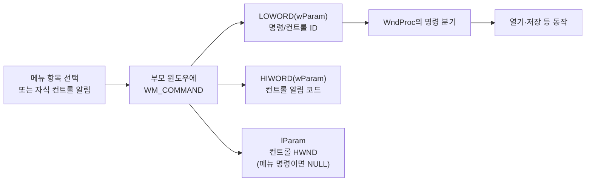

## Win API 학습 표준 컨트롤과 리소스 활용
목표
버튼, 에디트 컨트롤(텍스트 상자) 등 Windows가 기본으로 제공하는` UI` 컨트롤을 사용하는 방법을 익힙니다. 또한, 메뉴, 아이콘 등의 리소스를 소스 코드와 분리된 `리소스 파일(.rc)`로 관리하여 보다 체계적이고 유지보수가 용이한 프로그램을 만들 수 있게 됩니다.

## 1. 자식 윈도우(Child Window)로서의 컨트롤
Windows에서 버튼, 텍스트 상자, 리스트 박스 등 우리가 흔히 보는 UI 요소들은 사실 모두 그 자체로 하나의 독립된 '`윈도우`'입니다. 메인 윈도우 안에 포함되기 때문에 `자식 윈도우(Child Window)` 또는 `컨트롤(Control)` 이라고 부릅니다.

컨트롤 역시 CreateWindowEx 함수로 생성하지만, 몇 가지 차이점이 있습니다.

`lpClassName`: WNDCLASSEX로 등록한 우리만의 클래스 이름 대신, Windows에 미리 등록된 클래스 이름(예: "BUTTON", "EDIT", "LISTBOX")을 사용합니다.

`dwStyle:` WS_CHILD | WS_VISIBLE 스타일을 필수로 포함하여 부모 윈도우에 속해있고 화면에 보이도록 설정합니다.

`hWndParent`: 컨트롤이 속할 부모 윈도우의 핸들(HWND)을 지정합니다.

## 2. WM_COMMAND: 컨트롤로부터의 신호
사용자가 버튼을 클릭하거나 메뉴 항목을 선택하면, 해당 컨트롤은 부모 윈도우에게 "나에게 무슨 일이 일어났어!"라는 신호를 보냅니다. 이 신호가 바로 WM_COMMAND 메시지입니다.

WndProc에서 WM_COMMAND 메시지를 처리할 때, wParam 인자를 통해 어떤 컨트롤에서 이벤트가 발생했는지 식별할 수 있습니다.

`LOWORD(wParam)`: 이벤트를 발생시킨 컨트롤의 ID(고유 번호) 또는 메뉴 항목의 ID가 들어있습니다.

`HIWORD(wParam)`: 컨트롤로부터 온 알림 코드(Notification Code)가 들어있습니다. (예: 에디트 컨트롤의 텍스트가 변경되었을 때)

메뉴 명령은 `HIWORD(wParam) == 0`이며 `lParam`은 `NULL`입니다. 자식 컨트롤 명령은 `LOWORD(wParam)`의 컨트롤 ID와 `HIWORD(wParam)`의 알림 코드를 함께 확인하고, `lParam`으로 보낸 컨트롤의 `HWND`를 받을 수 있습니다. 모든 `WM_COMMAND`를 ID만으로 분기하면 같은 ID를 가진 서로 다른 알림을 구별하지 못할 수 있습니다.

**예제에서 추적하기**: [메뉴 리소스](./Notepad/SimpleNotepad.rc)의 `IDM_FILE_OPEN`이 [리소스 ID 헤더](./Notepad/resource.h)를 거쳐 [WndProc](./Notepad/SimpleNotepad.cpp)의 `case IDM_FILE_OPEN`으로 연결됩니다. `Open`을 눌렀을 때 `LOWORD(wParam)`이 이 ID이고 메뉴 알림 코드가 0인지 디버거에서 확인합니다.

## 3. 리소스(Resource)의 분리
지금까지 우리는 윈도우 제목 같은 문자열을 코드 안에 직접 작성했습니다. 하지만 프로그램의 규모가 커지면 아이콘, 메뉴, 이미지, 문자열 등을 코드와 분리하여 관리하는 것이 훨씬 효율적입니다. 이렇게 분리된 요소들을 리소스라고 합니다.

`리소스 스크립트 (.rc 파일)`: 리소스를 정의하는 텍스트 파일입니다. 메뉴의 구조, 대화 상자의 모양 등을 이곳에 코드로 기술합니다.

`리소스 헤더 (resource.h 파일):` 리소스 스크립트와 C++ 소스 코드 양쪽에서 공통으로 사용할 리소스 ID(예: IDM_FILE_OPEN)를 상수로 정의하는 파일입니다.

이렇게 리소스를 분리하면, 디자이너는 코드에 대한 지식 없이 리소스만 수정할 수 있고, 다국어 지원 등 확장성 면에서도 매우 유리해집니다. Visual Studio는 리소스를 시각적으로 편집할 수 있는 강력한 에디터를 제공합니다.

`.rc` 파일은 리소스 컴파일러가 실행 파일에 포함될 리소스로 변환합니다. `resource.h`의 숫자 ID는 C++과 `.rc` 사이의 계약이므로, ID를 바꾸면 양쪽에서 같은 정의를 사용하는지 확인합니다. 이 저장소의 메모장 예제는 메뉴 리소스를 윈도우 클래스에 연결하고 `WM_COMMAND`에서 해당 ID를 처리합니다.

## 실습: 간단한 메모장 만들기
이제 이 개념들을 종합하여, 마우스로 그림을 그리던 프로그램을 텍스트를 입력하고 파일로 저장할 수 있는 간단한 메모장으로 탈바꿈시켜 보겠습니다.

기능 요구사항:

프로그램이 실행되면 텍스트를 입력할 수 있는 에디트 컨트롤이 창 전체를 채운다.

창 크기를 조절하면 에디트 컨트롤의 크기도 함께 조절된다.

"File" 메뉴에 "Open", "Save", "Exit" 항목이 있다. 메뉴 문자열과 명령 ID는 리소스 스크립트에서 확인한다.

"Open"을 누르면 UTF-8 텍스트 파일을 열어 내용을 에디트 컨트롤에 표시한다.

"Save"를 누르면 에디트 컨트롤의 내용을 UTF-8 BOM이 포함된 텍스트 파일로 저장한다.

"Exit"를 누르면 프로그램이 종료된다.

`Help > About`은 간단한 정보 대화 상자를 표시합니다.

**완료 확인**: [메모장 예제](./Notepad/SimpleNotepad.cpp), [메뉴 리소스](./Notepad/SimpleNotepad.rc), [리소스 ID](./Notepad/resource.h)를 프로젝트에 포함합니다. 한글과 영문이 섞인 내용을 저장한 뒤 다시 열어 동일하게 표시되는지 확인합니다. 저장 경로가 쓰기 불가능하거나 파일을 읽을 수 없을 때 오류 안내가 나타나는지도 확인하고, `Help > About`에서 정보 대화 상자가 열리는지 살펴봅니다.