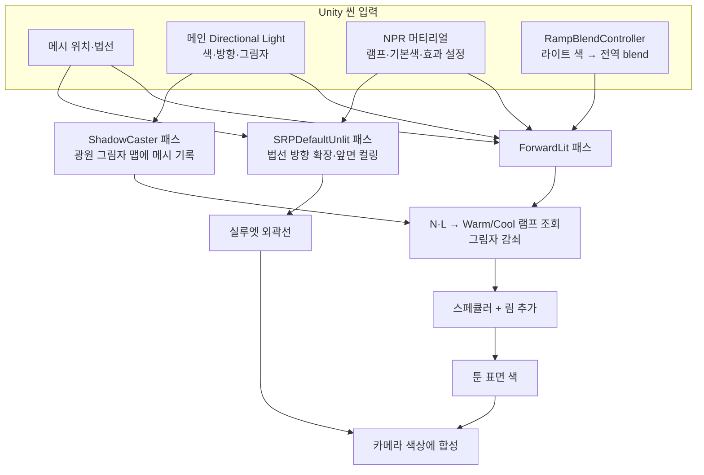

# NPR(툰) 셰이더 실습

URP 기반 툰 셰이더를 단계별로 만들어 보는 실습입니다. 제공된 Unity 프로젝트에 실행 자산과 데모 씬이 포함되어 있고, 아래 코드와 각 문서에서 구현 원리를 설명합니다.

## 환경

| 항목 | 값 |
|---|---|
| Unity | 2022.3 LTS |
| 렌더 파이프라인 | URP 14 (새 프로젝트 템플릿 `3D (URP)` 로 시작) |

> 이 저장소의 `NPR_shader.shader` 는 **Built-in 파이프라인용** 옛 버전입니다. URP 프로젝트에서는 분홍색으로 보이므로 쓰지 마세요. 아래 코드가 URP 용 최신본입니다.

## 제공 프로젝트에서 바로 실행하기

1. [`ShaderTestProject`](../../../../Projects/NPR%20Unity/ShaderTestProject/)를 Unity 2022.3으로 연다.
2. `Assets/Scenes/NPRDemo.unity`를 열고 Play를 눌러 NPR 구와 캡슐, 바닥 그림자를 확인한다.
3. 램프 색 전환을 시험하려면 `NPR Ramp Blend Controller`가 참조하는 Directional Light의 색을 주황색과 파란색 계열로 바꾼다.
4. 데모 자산을 다시 만들려면 `Tools > NPR > Create Demo Scene`을 실행한다. 이 메뉴는 램프 텍스처, 머티리얼, 씬을 재생성하고 씬을 Build Settings에 등록한다.

셰이더와 C# 구현은 이 Unity 프로젝트의 `Assets/Shaders/NPR/` 및 `Assets/Scripts/NPR/`에 포함되어 있습니다. 아래 코드 블록은 학습·비교를 위한 정본이며, 기존 실습 환경에 직접 복사하는 방법도 다음 절에서 설명합니다.

## 학습 순서

1. [램프 텍스처](./램프%20텍스처.md) — 툰 명암
2. [역면 확장 기법](./역면%20확장%20기법.md) — 외곽선
3. [림 라이트와 스페큘러](./림%20라이트와%20스페큘러.md) — 디테일
4. [다중 램프 혼합 시스템](./다중%20램프%20혼합%20시스템.md) — 환경별 램프 블렌딩

각 문서는 아래 "전체 코드"의 어느 부분을 설명하는지 맨 위에 적어 둡니다.

Unity 셰이더와 좌표 공간의 선행 개념은 [Unity 셰이더 학습 경로](../학습-경로.md)에서 보충할 수 있습니다. [네이티브 HLSL 학습 경로](../../HLSL/학습-경로.md)와 [Direct3D 11](../../../Graphics%20APIs/Direct3D%2011/DirectX%2011%20실습%20경로.md)은 호스트 프로그램과 API 바인딩까지 학습하려는 경우의 선택 자료이며 이 URP 데모의 선수 조건은 아닙니다.

## NPR 셰이더의 전체 구조

NPR(Non-Photorealistic Rendering)은 현실의 빛을 항상 더 정확히 모사하는 대신, 선·색·명암 같은 시각적 표현을 목적에 맞게 선택하는 렌더링 접근입니다. 이 데모는 PBR 셰이더가 아니라, 램프 색과 외곽선·림을 조절하는 **스타일 기반 포워드 셰이더**입니다. 따라서 각 단계에서 어떤 빛의 효과를 보존하고 단순화할지 직접 선택합니다.



**도식 읽기:** 그림자 패스는 화면에 외곽선을 그리는 패스와 다릅니다. ShadowCaster는 메인 라이트의 그림자 맵에 메시를 기록하고, ForwardLit은 그 결과를 샘플링해 툰 명암에 반영합니다. 외곽선은 별도의 `SRPDefaultUnlit` 메시 패스가 그립니다. 스페큘러와 림은 ForwardLit 패스 안에서 표면 색에 더해집니다.

**학습 질문:** 이 셰이더가 물리 기반 조명과 달리 예술적 선택을 하는 지점을 찾으세요. 예를 들어 하프 램버트는 뒤쪽 면을 완전히 자르지 않고, 그림자는 검은 램프 칸으로 표현하며, 림은 광원 색이나 그림자와 독립적으로 더해집니다. 각 선택이 결과 스타일에 주는 효과와 바꾸었을 때의 변화를 설명할 수 있으면 다음 실습으로 진행합니다.

## 데모 씬으로 실습하고 완료 확인하기

`NPRDemo` 씬에서 실습할 때는 Project 창의 `Assets/Materials/NPRToon.mat`을 선택해 머티리얼 값을 바꾸고, `Assets/Textures/NPR/`의 램프 텍스처를 편집합니다. 변경 전후의 결과를 기록한 뒤 아래 기준을 확인하세요.

| 순서 | 확인할 오브젝트·입력 | 실습 | 완료 기준 |
|---|---|---|---|
| 툰 램프 | `Toon Sphere`, `Ramp_Warm.png`, Directional Light | 라이트를 회전하고 램프의 어두운/중간/밝은 칸 색을 바꿉니다. 램프를 2칸 또는 5칸으로 바꿔 결과도 비교합니다. | 빛 방향에 따라 경계가 이동하고 램프 칸 수·색 변화가 구 표면에 반영되는 이유를 설명합니다. |
| 그림자 | 툰 오브젝트, `Ground`, Directional Light | 라이트를 움직이고 URP Main Light 그림자 설정과 라이트의 Shadow Type을 바꿉니다. | 툰 오브젝트가 바닥에 그림자를 만들며, 그림자에서 램프의 가장 어두운 색이 사용되는 것을 확인합니다. |
| 외곽선 | `NPRToon.mat`의 `_OutlineThickness`, `_OutlineDistanceFade` | 두께를 `0`과 `0.02`로 바꾸고, 카메라를 움직여 거리 페이드를 관찰합니다. | 두께가 0일 때 외곽선이 사라지고, 두께·거리에 따라 외곽선이 달라지는 것을 확인합니다. |
| 림·스페큘러 | `_RimWidth`, `_RimSharpness`, `_Glossiness`, `_SpecularThreshold` | 값을 하나씩 바꾸고 카메라 또는 라이트 각도를 움직입니다. `_Glossiness = 0`도 확인합니다. | 림은 실루엣 가장자리를 따르고, 스페큘러 영역은 임계값·광택에 따라 바뀌며 `_Glossiness = 0`에서도 전체가 하이라이트가 되지 않습니다. |
| 램프 혼합 | `NPR Ramp Blend Controller`가 참조하는 Directional Light 색 | 재생 중 라이트 색을 주황색과 파란색 계열 사이에서 바꿉니다. | 램프가 부드럽게 전환되고 `_NPR_RampBlend`가 머티리얼 프로퍼티가 아니라 전역 셰이더 값으로 제어되는 이유를 설명합니다. |

전체 완료 기준은 각 입력을 독립적으로 조절해 결과 변화를 설명하고, 씬에서 툰 조명·그림자·외곽선·림/스페큘러·램프 혼합을 확인하는 것입니다. 기능이 보이지 않으면 아래 문제 해결 표와 [각 효과 문서](#학습-순서)의 URP 설정을 먼저 확인합니다.

## 회귀 확인

환경이나 셰이더를 변경한 뒤에는 아래 순서로 확인하고, 결과를 공유할 때 실제 Unity Editor와 URP 버전을 함께 기록합니다.

1. `ProjectVersion.txt`의 Unity 버전으로 프로젝트를 열고 `Packages/manifest.json`의 URP 버전이 의도치 않게 바뀌지 않았는지 확인합니다.
2. `NPRDemo.unity`를 열어 셰이더·스크립트 컴파일 오류가 없는지 Console을 확인합니다. 오류가 있으면 Play와 Build 전에 먼저 해결합니다.
3. `NPRDemo`를 재생하고 툰 램프·바닥 그림자·외곽선·림/스페큘러·따뜻한/차가운 램프 전환을 각각 확인합니다.
4. 자산 생성 코드를 바꾼 경우 `Tools > NPR > Create Demo Scene`을 실행하고, 생성된 머티리얼의 램프 참조와 Build Settings의 씬 항목이 유지되는지 확인합니다. 기존 씬과 생성 자산은 덮어쓰기 전에 확인 창이 표시됩니다.
5. `File > Build Settings`에서 `NPRDemo` 씬이 포함되어 있는지 확인하고 Windows 플레이어를 빌드합니다. Unity 빌드 로그에서 NPR 셰이더 패스의 컴파일 오류가 없어야 합니다.

이 환경에서 Windows 플레이어 빌드는 Unity 2022.3.62f3 / URP 14.0.12로 확인했습니다. 이 배치 검증은 프로젝트가 고정한 Unity 2022.3.14f1 / URP 14.0.9 조합의 화면 결과를 대신하지 않습니다.

## 따라 하기

처음부터 구성하려면 `3D (URP)` 프로젝트에서 아래 절차를 따른다. 제공 프로젝트에서는 위의 바로 실행 절차를 사용하면 된다.

1. 아래 **전체 코드**의 `.shader` / `.hlsl` 파일 5개를 `Assets/Shaders/NPR/`에 만들고, `NPRRampBlendController.cs`를 `Assets/Scripts/NPR/`에 만든다.
2. **램프 텍스처 만들기**: 256×16 PNG 를 2장 만든다 (그림판/포토샵/아래 Python). 왼쪽에서 오른쪽으로 어두운색 → 밝은색을 **계단(3칸)** 으로 채운다. 예) Warm: (110,80,90) / (210,170,150) / (255,240,220), Cool: (60,70,120) / (130,150,200) / (225,235,255). 텍스처 Inspector 에서 **Wrap Mode = Clamp**.
3. `NPRToon.shader` 우클릭 → Create → Material. Warm Ramp / Cool Ramp 슬롯에 텍스처를 넣는다.
4. Sphere 를 만들어 머티리얼을 적용한다. Directional Light 를 돌려 **계단 모양 명암 + 외곽선 + 그림자**가 보이면 성공.
5. 빈 오브젝트에 `NPRRampBlendController` 를 붙이고 Main Light 슬롯에 Directional Light 를 연결한 뒤 라이트 색을 주황 ↔ 하늘색으로 바꿔 본다.

```python
# 램프 PNG 생성 (Pillow 필요: pip install pillow)
from PIL import Image
def ramp(name, colors):
    im = Image.new("RGB", (256, 16)); n = len(colors)
    for x in range(256):
        for y in range(16): im.putpixel((x, y), colors[x * n // 256])
    im.save(name)
ramp("Ramp_Warm.png", [(110,80,90), (210,170,150), (255,240,220)])
ramp("Ramp_Cool.png", [(60,70,120), (130,150,200), (225,235,255)])
```

## 전체 코드

**파일: `Assets/Shaders/NPR/NPRToon.shader`**
```hlsl
// NPR 툰 셰이더 (URP 14 / Unity 2022.3 기준)
// 구성: 램프 텍스처(Warm/Cool 블렌딩) + 그림자 수신 + 스페큘러 + 림 라이트 + 역면 확장 외곽선
// 패스별 코드는 같은 폴더의 .hlsl 파일에 있다. 공부할 때는 NPRToonPass.hlsl 부터 읽는다.
Shader "Tutorial/NPR/Toon"
{
    Properties
    {
        [Header(Main)]
        _Color ("기본 색상", Color) = (1,1,1,1)
        [NoScaleOffset] _WarmRamp ("따뜻한 램프", 2D) = "white" {}
        [NoScaleOffset] _CoolRamp ("차가운 램프", 2D) = "white" {}
        _ShadowStrength ("그림자 강도", Range(0,1)) = 1

        [Header(Outline)]
        _OutlineColor ("외곽선 색상", Color) = (0,0,0,1)
        _OutlineThickness ("외곽선 두께 (뷰 공간 단위)", Range(0, 0.1)) = 0.01
        _OutlineDistanceFade ("거리 페이드 (시작, 끝)", Vector) = (10, 50, 0, 0)

        [Header(Rim Light)]
        _RimColor ("림 색상", Color) = (1,1,1,1)
        _RimWidth ("림 시작 지점", Range(0, 1)) = 0.7
        _RimSharpness ("림 지수", Range(1, 5)) = 3

        [Header(Specular)]
        _SpecularColor ("스페큘러 색상", Color) = (1,1,1,1)
        _Glossiness ("광택", Range(0, 1)) = 0.5
        _SpecularThreshold ("하이라이트 컷 임계값", Range(0.5, 1)) = 0.9
    }

    SubShader
    {
        Tags { "RenderPipeline"="UniversalPipeline" "RenderType"="Opaque" "Queue"="Geometry" }

        Pass
        {
            Name "ForwardLit"
            Tags { "LightMode"="UniversalForward" }
            Cull Back

            HLSLPROGRAM
            #pragma vertex ToonVert
            #pragma fragment ToonFrag
            #pragma multi_compile _ _MAIN_LIGHT_SHADOWS _MAIN_LIGHT_SHADOWS_CASCADE _MAIN_LIGHT_SHADOWS_SCREEN
            #pragma multi_compile_fragment _ _SHADOWS_SOFT
            #include "NPRToonPass.hlsl"
            ENDHLSL
        }

        Pass
        {
            Name "Outline"
            // URP 는 LightMode 가 SRPDefaultUnlit 인 패스를 ForwardLit 다음에 추가로 그린다.
            Tags { "LightMode"="SRPDefaultUnlit" }
            Cull Front

            HLSLPROGRAM
            #pragma vertex OutlineVert
            #pragma fragment OutlineFrag
            #include "NPROutlinePass.hlsl"
            ENDHLSL
        }

        Pass
        {
            Name "ShadowCaster"
            Tags { "LightMode"="ShadowCaster" }
            ZWrite On
            ZTest LEqual
            ColorMask 0
            Cull Back

            HLSLPROGRAM
            #pragma vertex ShadowVert
            #pragma fragment ShadowFrag
            #pragma multi_compile_vertex _ _CASTING_PUNCTUAL_LIGHT_SHADOW
            #include "NPRShadowCaster.hlsl"
            ENDHLSL
        }
    }
}
```

**파일: `Assets/Shaders/NPR/NPRInput.hlsl`**
```hlsl
// NPRInput.hlsl
// 모든 패스가 공유하는 머티리얼 변수 선언.
// SRP Batcher 호환 조건: 머티리얼 프로퍼티는 모든 패스에서 "동일한" UnityPerMaterial CBUFFER 안에 있어야 한다.
// 그래서 선언을 한 파일로 모으고 각 패스가 #include 한다. (프로퍼티 추가/삭제 시 이 파일 + Properties 블록만 수정)
#ifndef NPR_INPUT_INCLUDED
#define NPR_INPUT_INCLUDED

#include "Packages/com.unity.render-pipelines.universal/ShaderLibrary/Core.hlsl"

TEXTURE2D(_WarmRamp);
TEXTURE2D(_CoolRamp);
// 이름이 sampler_point_clamp 이면 텍스처 임포트 설정과 무관하게 Point + Clamp 로 샘플링된다 (Unity 인라인 샘플러 규칙).
SAMPLER(sampler_point_clamp);

CBUFFER_START(UnityPerMaterial)
    half4 _Color;
    half  _ShadowStrength;
    half4 _OutlineColor;
    half  _OutlineThickness;
    half4 _OutlineDistanceFade; // x: 얇아지기 시작하는 거리, y: 두께가 0이 되는 거리
    half4 _RimColor;
    half  _RimWidth;
    half  _RimSharpness;
    half4 _SpecularColor;
    half  _Glossiness;
    half  _SpecularThreshold;
CBUFFER_END

// 머티리얼 프로퍼티가 아니라 C# (NPRRampBlendController) 이 Shader.SetGlobalFloat 로 넣는 전역 값.
// Properties 블록에 선언하면 머티리얼 값이 전역 값을 가려 버리므로 일부러 Properties 에 쓰지 않는다.
float _NPR_RampBlend; // 0 = Warm 램프, 1 = Cool 램프

#endif
```

**파일: `Assets/Shaders/NPR/NPRToonPass.hlsl`**
```hlsl
// NPRToonPass.hlsl : 본체 패스 (툰 램프 + 스페큘러 + 림 라이트 + 그림자 수신)
#ifndef NPR_TOON_PASS_INCLUDED
#define NPR_TOON_PASS_INCLUDED

#include "NPRInput.hlsl"
#include "Packages/com.unity.render-pipelines.universal/ShaderLibrary/Lighting.hlsl"

struct Attributes
{
    float4 positionOS : POSITION;
    float3 normalOS   : NORMAL;
};

struct Varyings
{
    float4 positionCS : SV_POSITION;
    float3 normalWS   : TEXCOORD0;
    float3 positionWS : TEXCOORD1;
};

Varyings ToonVert(Attributes IN)
{
    Varyings OUT;
    OUT.positionWS = TransformObjectToWorld(IN.positionOS.xyz);
    OUT.positionCS = TransformWorldToHClip(OUT.positionWS);
    OUT.normalWS   = TransformObjectToWorldNormal(IN.normalOS);
    return OUT;
}

half4 ToonFrag(Varyings IN) : SV_Target
{
    float3 normalWS = normalize(IN.normalWS);
    float3 viewDir  = GetWorldSpaceNormalizeViewDir(IN.positionWS);

    // 그림자 좌표 -> 메인 라이트 (shadowAttenuation 에 그림자 결과가 들어 있다)
    float4 shadowCoord = TransformWorldToShadowCoord(IN.positionWS);
    Light mainLight = GetMainLight(shadowCoord);
    float3 lightDir = mainLight.direction;
    half shadow = lerp(1.0h, mainLight.shadowAttenuation, _ShadowStrength);

    // 1) 램프 텍스처 : NdotL(-1~1) -> 0~1 -> 램프의 가로(U) 좌표
    half NdotL = dot(normalWS, lightDir) * 0.5h + 0.5h;
    half2 rampUV = half2(NdotL, 0.5h);
    half3 warm = SAMPLE_TEXTURE2D(_WarmRamp, sampler_point_clamp, rampUV).rgb;
    half3 cool = SAMPLE_TEXTURE2D(_CoolRamp, sampler_point_clamp, rampUV).rgb;
    half3 ramp = lerp(warm, cool, saturate(_NPR_RampBlend));
    // 그림자 안에서는 램프의 가장 어두운 칸을 쓴다 (단순 곱셈보다 만화 느낌이 유지된다)
    half3 darkest = lerp(SAMPLE_TEXTURE2D(_WarmRamp, sampler_point_clamp, half2(0, 0.5)).rgb,
                         SAMPLE_TEXTURE2D(_CoolRamp, sampler_point_clamp, half2(0, 0.5)).rgb,
                         saturate(_NPR_RampBlend));
    ramp = lerp(darkest, ramp, shadow);
    half3 color = _Color.rgb * ramp * mainLight.color;

    // 2) 스페큘러 : Blinn-Phong 을 step 으로 잘라 딱딱한 하이라이트로 만든다
    float3 halfDir = normalize(lightDir + viewDir);
    half exponent = max(1.0h, _Glossiness * 128.0h); // 0 이면 pow(x,0)=1 이 되어 전체가 빛나는 버그 방지
    half spec = pow(saturate(dot(normalWS, halfDir)), exponent);
    spec = step(_SpecularThreshold, spec) * shadow;
    color += _SpecularColor.rgb * spec;

    // 3) 림 라이트
    half rim = 1.0h - saturate(dot(viewDir, normalWS));
    rim = pow(rim, _RimSharpness);
    rim = smoothstep(_RimWidth, 1.0h, rim);
    color += _RimColor.rgb * rim;

    return half4(color, 1.0h);
}

#endif
```

**파일: `Assets/Shaders/NPR/NPROutlinePass.hlsl`**
```hlsl
// NPROutlinePass.hlsl : 역면 확장(Inverted Hull) 외곽선 패스
#ifndef NPR_OUTLINE_PASS_INCLUDED
#define NPR_OUTLINE_PASS_INCLUDED

#include "NPRInput.hlsl"

struct Attributes { float4 positionOS : POSITION; float3 normalOS : NORMAL; };
struct Varyings   { float4 positionCS : SV_POSITION; };

Varyings OutlineVert(Attributes IN)
{
    Varyings OUT;
    float3 positionWS = TransformObjectToWorld(IN.positionOS.xyz);
    float3 normalWS   = TransformObjectToWorldNormal(IN.normalOS);

    // 카메라 거리에 따라 두께를 줄인다. (분모가 0 이 되지 않도록 보호)
    float dist = distance(positionWS, _WorldSpaceCameraPos);
    float range = max(_OutlineDistanceFade.y - _OutlineDistanceFade.x, 1e-4);
    float fade = 1.0 - saturate((dist - _OutlineDistanceFade.x) / range);
    float thickness = _OutlineThickness * fade;

    // 뷰 공간에서 법선 방향으로 밀어낸다.
    float3 positionVS = TransformWorldToView(positionWS);
    float3 normalVS   = normalize(TransformWorldToViewDir(normalWS));
    positionVS += normalVS * thickness;

    OUT.positionCS = mul(GetViewToHClipMatrix(), float4(positionVS, 1.0));
    return OUT;
}

half4 OutlineFrag(Varyings IN) : SV_Target { return _OutlineColor; }

#endif
```

**파일: `Assets/Shaders/NPR/NPRShadowCaster.hlsl`**
```hlsl
// NPRShadowCaster.hlsl : 그림자 맵에 이 오브젝트를 그리는 패스 (URP Lit 의 ShadowCasterPass 와 같은 구조)
#ifndef NPR_SHADOW_CASTER_INCLUDED
#define NPR_SHADOW_CASTER_INCLUDED

#include "NPRInput.hlsl"
#include "Packages/com.unity.render-pipelines.core/ShaderLibrary/CommonMaterial.hlsl"
#include "Packages/com.unity.render-pipelines.universal/ShaderLibrary/Shadows.hlsl"

float3 _LightDirection;
float3 _LightPosition;

struct Attributes { float4 positionOS : POSITION; float3 normalOS : NORMAL; };
struct Varyings   { float4 positionCS : SV_POSITION; };

Varyings ShadowVert(Attributes IN)
{
    Varyings OUT;
    float3 positionWS = TransformObjectToWorld(IN.positionOS.xyz);
    float3 normalWS   = TransformObjectToWorldNormal(IN.normalOS);

#if _CASTING_PUNCTUAL_LIGHT_SHADOW
    float3 lightDirWS = normalize(_LightPosition - positionWS);
#else
    float3 lightDirWS = _LightDirection;
#endif

    float4 positionCS = TransformWorldToHClip(ApplyShadowBias(positionWS, normalWS, lightDirWS));
#if UNITY_REVERSED_Z
    positionCS.z = min(positionCS.z, UNITY_NEAR_CLIP_VALUE);
#else
    positionCS.z = max(positionCS.z, UNITY_NEAR_CLIP_VALUE);
#endif
    OUT.positionCS = positionCS;
    return OUT;
}

half4 ShadowFrag(Varyings IN) : SV_Target { return 0; }

#endif
```

**파일: `Assets/Scripts/NPR/NPRRampBlendController.cs`**
```csharp
using UnityEngine;

namespace ShaderStudy.NPR
{
    /// <summary>
    /// 메인 라이트 색이 따뜻하면 Warm 램프, 차가우면 Cool 램프를 쓰도록
    /// 전역 셰이더 값 _NPR_RampBlend (0=Warm, 1=Cool) 를 갱신한다.
    /// 셰이더 쪽 선언: NPRInput.hlsl 의 "float _NPR_RampBlend;"
    /// </summary>
    [ExecuteAlways]
    public class NPRRampBlendController : MonoBehaviour
    {
        static readonly int RampBlendId = Shader.PropertyToID("_NPR_RampBlend");

        [SerializeField] Light mainLight;
        [SerializeField, Min(0.01f)] float smoothTime = 0.5f;
        [SerializeField, Range(0f, 1f)] float currentBlend;

        float velocity;

        void Update()
        {
            if (mainLight == null) return;

            // r 이 b 보다 크면 따뜻한 빛(→0), 작으면 차가운 빛(→1)
            Color c = mainLight.color;
            float target = c.r >= c.b ? 0f : 1f;

            currentBlend = Application.isPlaying
                ? Mathf.SmoothDamp(currentBlend, target, ref velocity, smoothTime)
                : target; // 에디터(비재생)에서는 즉시 반영
            Shader.SetGlobalFloat(RampBlendId, currentBlend);
        }

        void OnDisable() => Shader.SetGlobalFloat(RampBlendId, 0f);
    }
}
```

## 자주 막히는 곳

| 증상 | 원인 / 해결 |
|---|---|
| 분홍색 | URP 가 아닌 프로젝트. `3D (URP)` 템플릿인지, Project Settings → Graphics 에 URP 에셋이 있는지 확인 |
| 외곽선이 안 보임 | `_OutlineThickness` 가 0 인지, 외곽선 패스의 `LightMode` 가 `SRPDefaultUnlit` 인지 확인 |
| 그림자를 안 받음 | Directional Light 의 Shadow Type 이 No Shadows 이거나 URP 에셋의 Main Light Cast Shadows 가 꺼짐 |
| 큐브 모서리에서 외곽선이 갈라짐 | 하드 에지 메시는 법선이 면마다 달라 생기는 현상. 구/캐릭터처럼 스무스 법선 메시로 확인 |

> **검증 상태**: Unity 2022.3.62f3 배치 실행에서 데모 생성 스크립트 컴파일과 씬·자산 생성까지 확인했습니다. 이 과정에서 패키지 관리자가 URP를 14.0.12로 올려 프로젝트 원래 설정(2022.3.14f1 / URP 14.0.9)은 복원했습니다. 따라서 고정된 프로젝트 버전에서의 셰이더 렌더 및 실제 화면 결과는 아직 확인되지 않았습니다.
