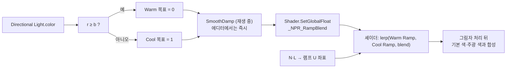

# 4. 다중 램프 혼합 시스템

> 코드: [README 의 전체 코드](./README.md#전체-코드) 중 `NPRToonPass.hlsl` (램프 lerp), `NPRInput.hlsl` (`_NPR_RampBlend`), `NPRRampBlendController.cs`

## 빛 색에서 셰이더 전역값까지

C# 스크립트는 Directional Light의 색으로 목표값을 선택하고, 셰이더는 전역 블렌드 값을 사용해 두 램프 샘플을 보간합니다. 머티리얼마다 램프 텍스처와 기본 색은 다를 수 있지만, 블렌드 값은 `Shader.SetGlobalFloat`로 모든 해당 셰이더 인스턴스에 공유됩니다.



## 목표
이 구현은 두 스타일의 명암 램프를 **하나의 전역 블렌드 값으로** 제어합니다. Warm/Cool 명칭은 예시 스타일이며, 실제 시간이나 색온도를 판정하는 기능은 아닙니다.

## 셰이더 쪽
```hlsl
half3 warm = SAMPLE_TEXTURE2D(_WarmRamp, sampler_point_clamp, rampUV).rgb;
half3 cool = SAMPLE_TEXTURE2D(_CoolRamp, sampler_point_clamp, rampUV).rgb;
half blend = saturate(_NPR_RampBlend);
half3 ramp = lerp(warm, cool, blend);
half3 darkest = lerp(
    SAMPLE_TEXTURE2D(_WarmRamp, sampler_point_clamp, half2(0, 0.5)).rgb,
    SAMPLE_TEXTURE2D(_CoolRamp, sampler_point_clamp, half2(0, 0.5)).rgb,
    blend);
ramp = lerp(darkest, ramp, shadow);
```

### ⚠ 전역 값과 Properties 의 함정
`_NPR_RampBlend`를 `Properties`와 `UnityPerMaterial` CBUFFER에 넣으면 머티리얼별 값이 전역 값을 가릴 수 있어 `Shader.SetGlobalFloat`가 의도대로 적용되지 않습니다. 이 예제에서는 값을 Properties/머티리얼 CBUFFER에 두지 않고 HLSL 전역 변수로 선언합니다.

`lerp(A, B, t)`는 `t=0`에서 Warm, `t=1`에서 Cool을 선택하고, 중간 값에서 두 색을 보간합니다. `saturate`는 전역 값이 `[0, 1]` 바깥으로 나가지 않게 제한합니다. 그림자용 어두운 색도 같은 전역 비율로 두 램프의 가장 어두운 칸을 보간한 뒤, 램프 샘플과 그림자 감쇠를 혼합합니다.

## C# 쪽
`NPRRampBlendController` 를 빈 오브젝트에 붙이고 Main Light 슬롯에 Directional Light 를 연결합니다.
- 빛 색의 `r >= b`이면 Warm(0), 아니면 Cool(1)을 목표값으로 선택합니다. 이는 붉은 채널과 파란 채널만 비교하는 단순 규칙입니다.
- 재생 중에는 `Mathf.SmoothDamp`로 전환하고, 에디터 비재생 상태에서는 목표값을 즉시 적용합니다. (`[ExecuteAlways]`)
- `Shader.SetGlobalFloat`이므로 같은 셰이더를 사용하는 머티리얼은 동일한 블렌드 값을 공유합니다. 머티리얼별 전환이 필요하면 전역 값 대신 머티리얼별 속성 또는 MaterialPropertyBlock 설계가 필요합니다.
- 메인 라이트 슬롯이 비어 있으면 `Update`는 전역 값을 새로 쓰지 않습니다. 컴포넌트가 비활성화될 때는 `OnDisable`이 전역값을 0(Warm)으로 되돌립니다.

테스트할 때 Directional Light 색을 주황과 파랑으로 바꾸고, 재생 모드와 에디터 비재생 모드를 각각 관찰합니다. 재생 중에는 전환이 부드럽고 비재생 중에는 목표 램프가 바로 선택됩니다.

## 한계와 확장
- 현재 `ToonFrag`는 URP 메인 라이트 하나만 계산합니다. 전역 램프 혼합은 다중 광원 지원을 의미하지 않습니다.
- `r >= b`는 색조의 거친 분류이지 낮/밤 감지나 물리적 색온도 추정이 아닙니다. 더 정교한 정책이 필요하면 사용자 지정 전환값, 색상 공간을 명시한 색조 판정, 시간/환경 입력을 별도로 설계합니다.
- 여러 광원별로 명암을 계산하려면 추가 광원 루프만 넣는 것으로 끝나지 않습니다. URP Additional Lights 설정과 셰이더 키워드, 각 광원의 거리 감쇠·그림자 정책, 여러 램프 결과의 합성 방식까지 정의해야 합니다.

이전: [림 라이트와 스페큘러](./림%20라이트와%20스페큘러.md)
