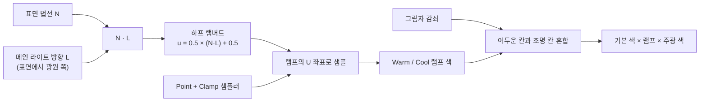

# 1. 툰 셰이딩과 램프 텍스처

> 코드: [README 의 전체 코드](./README.md#전체-코드) 중 `NPRToonPass.hlsl` 의 `ToonFrag` 앞부분

## 표면의 방향에서 색으로

램프는 단순히 명암을 줄이는 텍스처가 아니라, 표면과 주광 방향의 관계를 아티스트가 정한 색으로 바꾸는 **조회표(LUT)** 입니다.



## 목표
빛의 세기(0~1)를 부드러운 그라데이션 대신 **계단 모양 색**으로 바꿉니다.

## 원리
일반적인 Lambert 확산 항은 `max(0, N·L)` 입니다. `N`과 `L`은 정규화된 방향 벡터이며, 정면으로 빛을 받으면 내적이 1에 가깝고 빛의 반대쪽이면 0보다 작습니다. 이 예제는 이를 그대로 쓰는 대신 **하프 램버트(Half-Lambert)** 변환 `u = 0.5(N·L) + 0.5`를 사용합니다. 따라서 `N·L`의 범위 `[-1, 1]`을 램프의 U 좌표 `[0, 1]`로 옮기며, 빛의 반대쪽도 완전히 검게 자르지 않습니다.

이 변환은 물리적인 확산 반사 계산과 동일하지 않고, 어두운 쪽의 색을 보존하기 위한 스타일 선택입니다. 최종 밝기는 `GetMainLight(shadowCoord)`가 제공하는 주광 색과 그림자 감쇠에도 영향을 받습니다.

```hlsl
half NdotL = dot(normalWS, lightDir) * 0.5h + 0.5h;
half2 rampUV = half2(NdotL, 0.5h);
half3 ramp = SAMPLE_TEXTURE2D(_WarmRamp, sampler_point_clamp, rampUV).rgb;
half3 darkest = SAMPLE_TEXTURE2D(_WarmRamp, sampler_point_clamp, half2(0, 0.5h)).rgb;
ramp = lerp(darkest, ramp, shadow);
half3 color = _Color.rgb * ramp * mainLight.color;
```

- `lightDir`는 URP 메인 라이트에서 받아오는 **표면에서 광원 쪽** 방향입니다. 방향의 부호를 반대로 쓰면 밝고 어두운 면이 뒤집힙니다.
- `sampler_point_clamp`는 Unity 인라인 샘플러 규칙에 따른 Point + Clamp 설정입니다. Point 필터링은 칸 사이 색을 보간하지 않고, Clamp는 UV가 범위 밖일 때 끝 칸을 반복합니다.
- V 좌표를 `0.5`로 고정하는 이유는 램프가 가로 방향으로만 변하는 1차원 색상표이기 때문입니다.
- `shadow`가 1이면 조명 쪽 램프를 그대로 사용하고 0이면 램프의 가장 어두운 끝 칸을 사용합니다. 중간 감쇠는 두 색을 보간하므로 부드러운 그림자 경계에는 중간 색이 생길 수 있습니다.
- 이 예제는 `normalWS`와 `lightDir`를 픽셀 셰이더에서 내적합니다. 정점 법선은 래스터화 과정에서 보간된 뒤 픽셀 셰이더에서 정규화됩니다.

## 램프 텍스처
데모의 256×16 램프에서 U 좌표는 좌→우, 명암 구간은 어두움→밝음 순서입니다. 가로로 세 칸을 만들면 각 구간이 `N·L`의 서로 다른 범위를 담당합니다.

```text
램프 U:  0.0                 0.33                0.67                 1.0
         ├───────────────────┼───────────────────┼────────────────────┤
색상:    │      어두움       │       중간        │       밝음         │
         └───────────────────┴───────────────────┴────────────────────┘
N·L:    -1.0                 -0.33                0.33                 1.0
```

램프 파일을 바꾼 뒤 텍스처의 sRGB 설정을 확인하세요. 이 프로젝트는 아티스트가 고른 색상 값을 램프로 사용하며, 램프를 감마 공간에서 제작한 색과 선형 공간에서 연산하는 조명 값이 만나는 지점은 렌더 파이프라인의 색 공간 설정에 따라 달라질 수 있습니다.

## 실습
1. 머티리얼의 Warm Ramp 슬롯에 직접 만든 램프를 넣고 Directional Light 를 회전시킵니다.
2. 램프를 2칸/5칸으로 직접 만들어 교체해 봅니다.
3. `dot(normalWS, lightDir) * 0.5 + 0.5`를 `saturate(dot(normalWS, lightDir))`로 바꿔 어두운 면과 램프가 쓰이는 U 범위를 비교합니다.
4. 임시로 `sampler_point_clamp`를 선형 필터링 샘플러로 바꿔 칸 경계가 어떻게 달라지는지 비교합니다.
5. `_ShadowStrength`를 0과 1 사이에서 바꿔 램프 색과 주광 그림자 감쇠의 관계를 확인합니다.

## 그림자
정점 셰이더에서 월드 위치를 전달하고, 픽셀 셰이더에서 `TransformWorldToShadowCoord`와 `GetMainLight(shadowCoord)`로 메인 라이트의 그림자 감쇠를 얻습니다. `_ShadowStrength`는 그림자 효과를 머티리얼에서 얼마나 적용할지 조절합니다. Directional Light에 그림자 투사가 설정되어 있어도 URP 에셋에서 Main Light Shadows가 비활성화되어 있으면 그림자 감쇠를 받을 수 없습니다.

다음: [역면 확장 기법](./역면%20확장%20기법.md)
