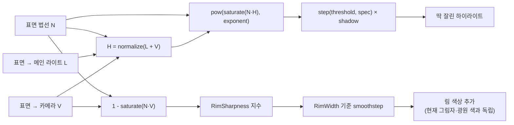

# 3. 림 라이트와 스페큘러

> 코드: [README 의 전체 코드](./README.md#전체-코드) 중 `NPRToonPass.hlsl` 의 `ToonFrag` 뒷부분

## 두 효과가 보는 방향은 다르다

스페큘러는 표면 법선 `N`, 광원 방향 `L`, 시선 방향 `V`를 모두 사용합니다. 림은 이 셰이더에서 `N`과 `V`만 비교하므로 메인 라이트 방향이나 그림자 감쇠와 독립적으로 더해집니다.



## 스페큘러 (딱딱한 하이라이트)
Blinn–Phong 계열의 `pow(saturate(N·H), n)` 값에 임계값을 적용해 경계가 뚜렷한 하이라이트를 만듭니다. `H`는 빛과 시선 방향의 중간 벡터이며, 표면 법선이 이 벡터와 가까울수록 원래 스페큘러 값이 커집니다.

```hlsl
float3 halfDir = normalize(lightDir + viewDir);
half exponent  = max(1.0h, _Glossiness * 128.0h);
half spec = pow(saturate(dot(normalWS, halfDir)), exponent);
spec = step(_SpecularThreshold, spec) * shadow;
```
- `H = normalize(L + V)`입니다. 코드의 `lightDir`, `viewDir`, `normalWS`는 월드 공간 벡터입니다. 서로 다른 공간의 방향 벡터를 내적하면 의미 있는 조명 결과가 나오지 않습니다.
- `_Glossiness`는 여기서 전통적인 재질 광택 매개변수가 아니라 지수 `n = max(1, _Glossiness × 128)`로 변환됩니다. 지수가 커지면 하이라이트의 원래 봉우리가 좁아집니다.
- 지수를 1 이상으로 제한하는 이유는 `pow(x, 0) = 1`이 되어 전체 표면이 하이라이트가 되는 경우를 막기 위해서입니다.
- `step(threshold, spec)`은 `spec`이 임계값보다 작으면 0, 크거나 같으면 1을 반환합니다. 따라서 임계값을 높이면 켜지는 영역이 작아집니다. 다만 최종 결과는 0/1 마스크이며, 지수를 낮추는 것만으로 최종 하이라이트가 반드시 작아지는 것은 아닙니다. 임계값과 함께 관찰하세요.
- 그림자 안에서 하이라이트를 끄기 위해 `shadow`를 곱합니다. 이 코드의 `shadow`는 `_ShadowStrength`가 반영된 메인 라이트 그림자 값입니다.
- 하이라이트 색은 `_SpecularColor`를 더하며, 메인 라이트 색상은 현재 스페큘러 항에 별도로 곱하지 않습니다. 이는 이 예제의 스타일 선택입니다.

## 림 라이트
표면 법선과 시선 방향의 내적은 표면을 정면에서 바라볼 때 1에 가깝고, 실루엣에서는 0에 가깝습니다. 따라서 `1 - saturate(N·V)`는 실루엣 근처에서 커집니다. 이를 지수 곡선과 임계 전이로 조절해 가장자리 색을 추가합니다.

```hlsl
half rim = 1.0h - saturate(dot(viewDir, normalWS));
rim = pow(rim, _RimSharpness);
rim = smoothstep(_RimWidth, 1.0h, rim);
color += _RimColor.rgb * rim;
```
- `_RimSharpness`는 `rim`이 `smoothstep`에 들어가기 전의 지수입니다. 값이 커지면 0과 1 사이 값이 줄어 가장자리의 가장 바깥쪽에 효과가 집중됩니다.
- `_RimWidth`는 `smoothstep`의 시작 경계이고 끝 경계는 1입니다. 시작 경계를 올리면 림이 좁아집니다.
- 현재 림 항에는 `shadow`나 `mainLight.color`를 곱하지 않습니다. 그러므로 그림자 안에서도 림이 보이고, 라이트 색을 바꿔도 림 색 자체는 `_RimColor`가 결정합니다. 그림자에 림을 끄거나 광원 색을 따르게 하려면 그 동작을 의도적으로 추가해야 합니다.
- `smoothstep(edge0, edge1, x)`는 경계 사이를 부드럽게 전이합니다. 경계를 가깝게 하면 전이 폭이 좁아져 더 선명해지지만, 완전히 이진적인 경계가 필요하면 `step`을 사용할 수 있습니다.

## 실습
1. `_SpecularThreshold` 를 0.5 → 1.0 으로 움직여 하이라이트 크기 변화를 본다.
2. `_Glossiness` 를 0 으로 놓고도 화면이 깨지지 않는지 확인한다.
3. `_Glossiness`를 고정한 채 threshold를 바꾸고, 이어서 threshold를 고정한 채 glossiness를 바꿔 원래 스페큘러와 잘린 마스크의 차이를 관찰한다.
4. 카메라를 정면에서 실루엣 방향으로 이동해 `N·V`와 림 폭의 관계를 확인한다.
5. 라이트를 돌리고 그림자 안팎을 비교해 림이 메인 라이트·그림자와 독립적으로 더해지는 현재 구현을 확인한다.
6. `smoothstep(_RimWidth, min(_RimWidth + 0.02, 1.0), rim)`으로 전이 폭을 줄여 기본 설정과 비교한다.

이전: [역면 확장 기법](./역면%20확장%20기법.md) / 다음: [다중 램프 혼합 시스템](./다중%20램프%20혼합%20시스템.md)
