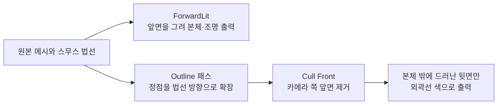
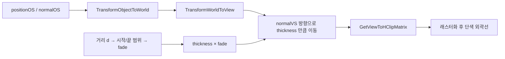

# 2. 역면 확장(Inverted Hull)으로 외곽선 그리기

> 코드: [README 의 전체 코드](./README.md#전체-코드) 중 `NPROutlinePass.hlsl`, 패스 선언은 `NPRToon.shader` 의 `Outline` 패스

## 두 번 그려 실루엣을 만든다

본체 패스는 일반적인 앞면을 그리고, 외곽선 패스는 메시를 조금 확장한 뒤 카메라를 향하는 면을 제거합니다. 확장된 뒷면 중 본체 바깥으로 나온 부분만 색칠되어 테두리처럼 보입니다.



## 원리
1. 본체를 평소처럼 그린다.
2. 같은 메시를 한 번 더 그리되 **앞면을 컬링(`Cull Front`)** 해서 뒷면만 보이게 하고,
3. 정점을 법선 방향으로 조금 **부풀려** 단색으로 칠한다.

부풀려진 메시가 본체보다 넓게 덮는 영역은 깊이 검사에서 본체 뒤에 가려집니다. 대신 실루엣 바깥에 나온 뒷면은 가려지지 않으므로 외곽선으로 보입니다. 메시의 정점 법선을 이용하므로 선의 위치와 모양은 메시 토폴로지 및 법선에 의존합니다.

## 공간 변환과 거리 페이드

현재 코드는 오브젝트 정점과 법선을 월드 공간으로 바꾸고, 다시 뷰 공간에서 확장한 뒤 클립 공간으로 투영합니다.



뷰 공간 확장 값은 카메라 방향과 무관하게 카메라 기준 거리 단위를 사용하지만, **일정한 화면 픽셀 두께를 보장하지는 않습니다.** 원근 투영 때문에 같은 뷰 공간 확장이라도 멀리 있는 물체의 화면상 외곽선은 더 얇아집니다. 이 셰이더는 `_OutlineDistanceFade`로 추가 감쇠를 적용해 먼 거리에서 외곽선을 더 얇게 만듭니다.

## URP 에서의 포인트
- URP 에서 본 셰이더 패스는 `UniversalForward`, 외곽선 패스는 **`SRPDefaultUnlit`** 태그를 사용합니다. 별도의 `ShadowCaster` 패스는 빛의 그림자 맵에 메시를 넣기 위한 패스이며 화면 외곽선으로 사용하지 않습니다.
- ⚠ 흔한 실수: 외곽선 패스에 `Tags { "LightMode"="ShadowCaster" }` 를 달면 이 패스가 그림자 패스로 취급되어 **화면에 외곽선이 그려지지 않습니다.**

```hlsl
float dist  = distance(positionWS, _WorldSpaceCameraPos);
float range = max(_OutlineDistanceFade.y - _OutlineDistanceFade.x, 1e-4);   // 0 나눗셈 방지
float fade  = 1.0 - saturate((dist - _OutlineDistanceFade.x) / range);     // 멀수록 0
float3 positionVS = TransformWorldToView(positionWS);
float3 normalVS   = normalize(TransformWorldToViewDir(normalWS));
positionVS += normalVS * (_OutlineThickness * fade);                        // 뷰 공간에서 부풀림
OUT.positionCS = mul(GetViewToHClipMatrix(), float4(positionVS, 1));
```

- `_OutlineDistanceFade.x`는 페이드 시작 거리, `.y`는 두께가 0이 되는 거리입니다. 두 값의 순서가 뒤집히지 않도록 설정합니다.
- `normalWS`는 `TransformObjectToWorldNormal`로 구한 월드 법선이며, 뷰 공간으로 변환한 뒤 정규화해서 확장 방향으로 사용합니다.
- `Cull Front`와 깊이 테스트는 서로 다른 역할입니다. 컬링은 면의 방향으로 그릴지 결정하고, 깊이 테스트는 이미 그려진 본체 뒤에 있는 픽셀을 가립니다.

## 한계
- 하드 에지(큐브)는 정점 법선이 면마다 달라 모서리에서 외곽선이 갈라집니다. 스무스 법선 메시에서 쓰는 기법입니다.
- 얇은 오브젝트/내부 선은 그리지 못합니다 → 후처리 기반 외곽선(깊이/법선 엣지 검출)이 대안입니다.
- 메시 전체를 팽창하므로 오목한 모양, 겹치는 부분, 높은 곡률에서는 두께가 불균일하거나 외곽선이 서로 겹칠 수 있습니다.
- 확장량을 지나치게 키우면 실루엣이 변형되거나 본체를 가리는 면적이 커집니다. 외곽선은 물리적으로 생긴 선이 아니라 화면 표현을 위한 메시 기반 효과입니다.

## 실습
1. `_OutlineThickness`, `_OutlineColor` 를 바꿔 본다.
2. 카메라를 멀리 보내며 `_OutlineDistanceFade` (시작, 끝) 의 효과를 확인한다.
3. `Cull Front` 를 `Cull Back` 으로 바꾸면 무슨 일이 생기는지 관찰한다.
4. 구와 캡슐에 같은 외곽선 설정을 적용하고, 기본 큐브와 스무스 법선 메시의 차이를 비교한다.
5. `_OutlineThickness = 0`과 큰 값(예: `0.04`)에서 본체 외곽과 겹침이 어떻게 달라지는지 확인한다.

이전: [램프 텍스처](./램프%20텍스처.md) / 다음: [림 라이트와 스페큘러](./림%20라이트와%20스페큘러.md)
