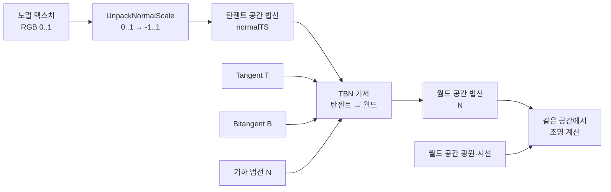
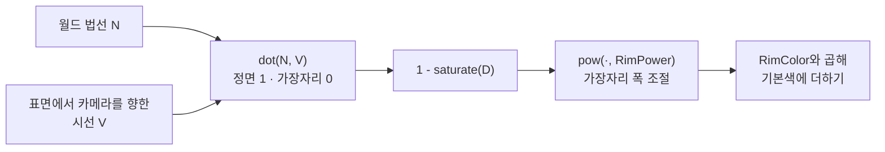
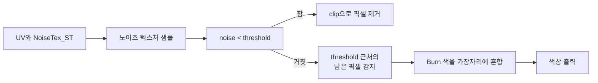
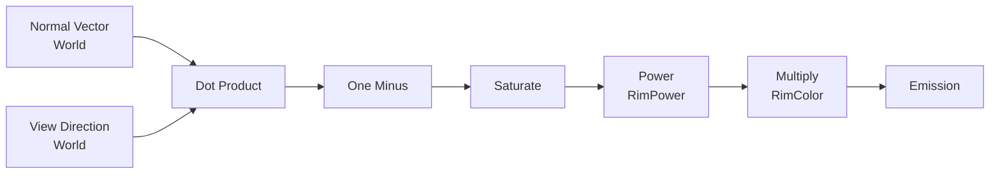

## Unity 셰이더: 노멀 매핑, 프레넬, 디졸브
이 문서는 Unity 셰이더 경로의 노멀 매핑, 프레넬, 디졸브, 셰이더 그래프 모듈을 다룹니다. 모듈은 개념의 순서일 뿐이며, 정해진 학습 기간은 없습니다.

> **따라 하기 환경**: Unity 2022.3 LTS + URP 14 (새 프로젝트 템플릿 `3D (URP)`). 셰이더는 `Project 창 → Create → Shader → Unlit Shader`(또는 Empty Shader)로 파일을 만들고 내용을 전부 붙여 넣은 뒤, 셰이더 우클릭 → Create → Material → 오브젝트에 적용합니다. 코드는 에디터에서 직접 컴파일해 검증하지 못했으므로 콘솔 에러가 나면 알려 주세요.

## 모듈 9: 노멀 매핑과 고급 텍스처

`노멀 맵 (Normal Map)`

노멀 맵은 로우폴리(Low-poly) 모델 표면에 하이폴리(High-poly) 모델의 디테일한 음영 정보를 텍스처 형태로 저장한 것입니다. 픽셀 단위로 표면의 법선(Normal) 방향을 속여, 실제로 폴리곤이 더 많은 것처럼 보이게 하는 착시를 일으킵니다.

`RGB 채널`은 각각 법선 벡터의 X, Y, Z 방향을 나타냅니다. (보통 Z가 위쪽을 향함)

이를 통해 아주 적은 비용으로 시각적 퀄리티를 크게 향상할 수 있습니다.

`탄젠트 공간` (Tangent Space)
노멀 매핑을 올바르게 적용하기 위해 사용되는 국소적인 좌표계입니다. 모델의 각 표면(폴리곤)에 접하는 평면을 기준으로 설정됩니다.

`Normal (N)`: 표면의 법선 방향 (위쪽)

`Tangent (T)`: 표면의 가로 방향 (보통 UV의 U 방향)

`Bitangent (B)`: 표면의 세로 방향 (보통 UV의 V 방향)

노멀 맵에 저장된 법선은 탄젠트 공간 기준이므로, 조명 벡터와 같은 공간에서 계산해야 합니다. 두 가지 방법이 있습니다: (a) 광원/시선 벡터를 탄젠트 공간으로 보낸다, (b) 노멀 맵의 법선을 TBN 행렬로 **월드 공간으로 변환**한다. 이 문서의 예제는 (b)를 사용합니다.



노멀 텍스처의 RGB는 색상으로 표시되지만, 실제 의미는 방향입니다. 평평한 영역의 대표 색 `(0.5, 0.5, 1)`은 대략 탄젠트 공간의 `(0, 0, 1)`을 뜻합니다. 이를 그대로 월드 공간 조명에 넣으면 좌표계가 달라 결과가 틀어집니다. TBN의 세 축을 사용해 월드 공간으로 변환하고 정규화한 뒤, 월드 공간의 광원·시선 방향과 조명 계산을 해야 합니다.

앞선 조명 모듈에서 만든 Blinn-Phong 셰이더에 노멀 매핑을 추가하는 코드입니다.
**파일: `Assets/Shaders/Lessons/NormalMapped.shader`**
```hlsl
// 고급 셰이더 모듈: 노멀 매핑 (탄젠트 공간 -> 월드 공간) + Lambert + Blinn-Phong
Shader "Lessons/NormalMapped"
{
    Properties
    {
        _BaseColor ("Base Color", Color) = (1,1,1,1)
        _MainTex ("Base Texture", 2D) = "white" {}
        [Normal] _NormalMap ("Normal Map", 2D) = "bump" {}
        _NormalScale ("Normal Scale", Range(0,2)) = 1
        _Shininess ("Shininess", Range(0.1, 100)) = 20
    }
    SubShader
    {
        Tags { "RenderPipeline"="UniversalPipeline" "RenderType"="Opaque" }
        Pass
        {
            Tags { "LightMode"="UniversalForward" }
            HLSLPROGRAM
            #pragma vertex vert
            #pragma fragment frag
            #include "Packages/com.unity.render-pipelines.universal/ShaderLibrary/Core.hlsl"
            #include "Packages/com.unity.render-pipelines.universal/ShaderLibrary/Lighting.hlsl"

            struct Attributes
            {
                float4 positionOS : POSITION;
                float3 normalOS   : NORMAL;
                float4 tangentOS  : TANGENT;
                float2 uv         : TEXCOORD0;
            };
            struct Varyings
            {
                float4 positionHCS : SV_POSITION;
                float2 uv          : TEXCOORD0;
                float3 normalWS    : TEXCOORD1;
                float3 tangentWS   : TEXCOORD2;
                float3 bitangentWS : TEXCOORD3;
                float3 positionWS  : TEXCOORD4;
            };

            TEXTURE2D(_MainTex);   SAMPLER(sampler_MainTex);
            TEXTURE2D(_NormalMap); SAMPLER(sampler_NormalMap);
            CBUFFER_START(UnityPerMaterial)
                float4 _MainTex_ST;
                half4 _BaseColor;
                half _NormalScale;
                half _Shininess;
            CBUFFER_END

            Varyings vert(Attributes IN)
            {
                Varyings OUT;
                OUT.positionWS  = TransformObjectToWorld(IN.positionOS.xyz);
                OUT.positionHCS = TransformWorldToHClip(OUT.positionWS);
                OUT.uv          = TRANSFORM_TEX(IN.uv, _MainTex);
                OUT.normalWS    = TransformObjectToWorldNormal(IN.normalOS);
                OUT.tangentWS   = TransformObjectToWorldDir(IN.tangentOS.xyz);
                // tangent.w 는 바이탄젠트 방향(좌/우수 좌표계 보정)
                OUT.bitangentWS = cross(OUT.normalWS, OUT.tangentWS) * IN.tangentOS.w * GetOddNegativeScale();
                return OUT;
            }

            half4 frag(Varyings IN) : SV_Target
            {
                half3 normalTS = UnpackNormalScale(SAMPLE_TEXTURE2D(_NormalMap, sampler_NormalMap, IN.uv), _NormalScale);
                float3x3 tbn = float3x3(normalize(IN.tangentWS), normalize(IN.bitangentWS), normalize(IN.normalWS));
                float3 N = normalize(TransformTangentToWorld(normalTS, tbn));

                Light light = GetMainLight();
                float3 L = light.direction;
                float3 V = GetWorldSpaceNormalizeViewDir(IN.positionWS);
                float3 H = normalize(L + V);

                half3 albedo = SAMPLE_TEXTURE2D(_MainTex, sampler_MainTex, IN.uv).rgb * _BaseColor.rgb;
                half diffuse = saturate(dot(N, L));
                half specular = pow(saturate(dot(N, H)), _Shininess) * step(0.0, diffuse);
                return half4((albedo * diffuse + specular) * light.color, 1);
            }
            ENDHLSL
        }
    }
}
```

> 핵심: TBN 행렬로 노멀맵(탄젠트 공간)을 월드 공간으로 변환. 노멀맵 텍스처의 Texture Type 을 Normal map 으로 지정해야 합니다. 이 예제는 메시에 접선(`TANGENT`) 데이터가 포함되어야 합니다.

#### 실습: 노멀 텍스처의 입력과 좌표계를 확인하기

1. 같은 조명과 머티리얼로 평평한 Quad를 준비하고 Base Texture를 지정한 뒤, 먼저 `_NormalScale`을 `0`으로 둡니다. 표면이 기하 법선만으로 조명되는 기준 결과를 기록합니다.
2. 노멀 맵을 할당합니다. Unity가 일반 텍스처로 가져왔다면 Import Settings의 **Texture Type**을 **Normal map**으로 바꾸고 적용합니다. 노멀 맵은 색상 데이터가 아니므로 sRGB 색상 텍스처로 샘플링하지 않습니다.
3. `_NormalScale`을 `0`, `0.5`, `1`, `2` 순서로 바꾸어 미세 요철의 조명 대비를 비교합니다. 스케일이 커질수록 편향된 법선 효과가 강해지지만, 메시의 실루엣 자체가 바뀌지는 않습니다.
4. 조명 방향을 옮겨 표면의 하이라이트와 음영이 노멀 맵 패턴을 따라 이동하는지 확인합니다. 효과가 없으면 메시의 `TANGENT` 입력, 노멀 맵 임포트 타입, 셰이더에서 노멀 샘플을 사용하는지 확인합니다.

**완료 확인**: 노멀 맵의 평평한 값 `(0.5, 0.5, 1)`이 탄젠트 공간의 앞 방향을 뜻한다는 것과, TBN 변환이 필요한 이유를 말할 수 있습니다. 노멀 매핑은 조명 음영을 바꾸지만 추가 정점을 생성하거나 실루엣을 바꾸지는 않습니다.

## 모듈 10: 프레넬과 림 라이팅

`프레넬 효과` (Fresnel Effect)
물체의 표면을 비스듬하게 볼수록 반사율이 높아지는 물리 현상입니다. 여기서 각도는 시선 벡터와 표면 법선 사이의 각도입니다. 정면에서는 두 벡터가 나란하고, 표면을 스치듯 볼 때는 두 벡터가 거의 수직입니다. 대부분의 비금속 물질이 이 특성을 가집니다.

그래픽스에서는 `시선 벡터`(View Direction)와 표면의 `법선 벡터`(Normal)의 `내적`(Dot Product)을 이용하여 이 효과를 근사합니다.

`1 - saturate(dot(normal, viewDir))` 공식을 통해 시선이 표면에 수직일 때(정면)는 0, 수평에 가까울 때(가장자리)는 1에 가까운 값을 얻을 수 있습니다.



이 셰이더의 `pow(1 - dot(N,V), RimPower)`는 프레넬의 각도 의존성을 이용한 **시각 효과용 근사**이며, 재질의 물리적 반사율을 계산하는 완전한 프레넬 방정식은 아닙니다. `_RimPower`가 커질수록 빛나는 영역은 가장자리 가까이 좁아집니다.

`림 라이팅 (Rim Lighting)`
프레넬 효과를 응용하여 물체의 외곽선이 빛나는 것처럼 보이게 하는 기법입니다. 캐릭터나 중요한 오브젝트를 배경과 분리하고 강조하는 데 효과적입니다. 카툰 렌더링에 사용되기도 합니다.


오브젝트의 외곽선에 지정된 색상의 빛이 감돌게 하는 림 라이팅 셰이더 코드입니다.
**파일: `Assets/Shaders/Lessons/SimpleRim.shader`**
```hlsl
// 고급 셰이더 모듈: 프레넬 림 라이트
Shader "Lessons/SimpleRim"
{
    Properties
    {
        _BaseColor ("Base Color", Color) = (1,1,1,1)
        _RimColor ("Rim Color", Color) = (0,1,1,1)
        _RimPower ("Rim Power", Range(0.1, 10)) = 3
    }
    SubShader
    {
        Tags { "RenderPipeline"="UniversalPipeline" "RenderType"="Opaque" }
        Pass
        {
            Tags { "LightMode"="UniversalForward" }
            HLSLPROGRAM
            #pragma vertex vert
            #pragma fragment frag
            #include "Packages/com.unity.render-pipelines.universal/ShaderLibrary/Core.hlsl"
            #include "Packages/com.unity.render-pipelines.universal/ShaderLibrary/Lighting.hlsl"

            struct Attributes { float4 positionOS : POSITION; float3 normalOS : NORMAL; };
            struct Varyings   { float4 positionHCS : SV_POSITION; float3 normalWS : TEXCOORD0; float3 positionWS : TEXCOORD1; };
            CBUFFER_START(UnityPerMaterial)
                half4 _BaseColor;
                half4 _RimColor;
                half  _RimPower;
            CBUFFER_END

            Varyings vert(Attributes IN)
            {
                Varyings OUT;
                OUT.positionWS  = TransformObjectToWorld(IN.positionOS.xyz);
                OUT.positionHCS = TransformWorldToHClip(OUT.positionWS);
                OUT.normalWS    = TransformObjectToWorldNormal(IN.normalOS);
                return OUT;
            }
            half4 frag(Varyings IN) : SV_Target
            {
                float3 N = normalize(IN.normalWS);
                float3 V = GetWorldSpaceNormalizeViewDir(IN.positionWS);
                Light light = GetMainLight();
                half lambert = saturate(dot(N, light.direction));
                half rim = pow(1.0 - saturate(dot(N, V)), _RimPower);
                half3 color = _BaseColor.rgb * lambert * light.color + _RimColor.rgb * rim;
                return half4(color, 1);
            }
            ENDHLSL
        }
    }
}
```

> 핵심: `rim = pow(1 - saturate(dot(N,V)), _RimPower)`.

#### 실습: 카메라 각도와 림 폭 비교하기

1. 구처럼 표면 법선 방향이 연속적으로 변하는 오브젝트에 셰이더를 적용하고 `_RimPower`를 `1`, `3`, `8`로 바꿉니다. 각 값에서 림 영역의 폭과 중앙부 밝기를 비교합니다.
2. 카메라를 오브젝트 정면에서 가장자리 방향으로 이동합니다. 정면을 볼 때보다 비스듬히 볼 때 림이 넓게 나타나는지 관찰합니다.
3. `_RimColor`를 어두운 배경과 비슷한 색, 대비가 큰 색으로 각각 바꾸어 가독성을 비교합니다. 효과가 나타나지 않으면 월드 공간 법선과 월드 공간 시선이 사용되는지 확인합니다.

**완료 확인**: 내적이 정면에서 1, 가장자리에서 0에 가까워지는 이유와 `1 - dot(N,V)`가 가장자리에서 커지는 이유를 설명할 수 있습니다. 이 림 효과가 물리 기반 반사 계산과는 다른 아트 디렉션용 근사임도 구분합니다.

## 모듈 11: 디졸브 및 왜곡 효과

`디졸브 효과 (Dissolve Effect)`
노이즈 텍스처와 clip() 함수를 이용해 오브젝트가 타거나 녹아 없어지는 듯한 효과를 만듭니다.

`노이즈 텍스처`의 흑백 값(0~1)과 인스펙터에서 조절하는 임계값(Threshold)을 비교합니다.

`clip(noiseValue - threshold)`: 노이즈 값이 임계값보다 작으면 해당 픽셀을 그리지 않아 구멍이 뚫린 것처럼 보입니다.

임계값 주변에 특정 색상을 더해주면 타들어 가는 듯한 테두리 효과`(Burn Edge)`를 추가할 수 있습니다.



`왜곡/굴절 효과 (Distortion/Refraction)`
배경 화면을 텍스처로 가져와야 합니다. Built-in 파이프라인에서는 `GrabPass`를 쓰지만, **URP 에서는 `GrabPass`가 지원되지 않으므로** URP 에셋에서 Opaque Texture 를 켜고 `_CameraOpaqueTexture` 를 샘플링합니다(`SampleSceneColor`). 이 텍스처를 샘플링할 UV 좌표를 노멀 맵 등을 이용해 살짝 왜곡하면, 배경이 아지랑이나 유리를 통해 보는 것처럼 굴절되어 보이는 효과를 만들 수 있습니다.


임계값에 따라 오브젝트가 사라지는 디졸브 셰이더 코드입니다.
**파일: `Assets/Shaders/Lessons/SimpleDissolve.shader`**
```hlsl
// 고급 셰이더 모듈: 노이즈 텍스처 + clip 으로 만드는 디졸브
Shader "Lessons/SimpleDissolve"
{
    Properties
    {
        _MainTex ("Texture", 2D) = "white" {}
        _NoiseTex ("Noise Texture", 2D) = "gray" {}
        _Threshold ("Dissolve Threshold", Range(0,1)) = 0.5
        _EdgeWidth ("Burn Edge Width", Range(0.001,0.2)) = 0.05
        _EdgeColor ("Burn Edge Color", Color) = (1,0.25,0,1)
    }
    SubShader
    {
        Tags { "RenderPipeline"="UniversalPipeline" "RenderType"="TransparentCutout" "Queue"="AlphaTest" }
        Pass
        {
            Tags { "LightMode"="UniversalForward" }
            Cull Off
            HLSLPROGRAM
            #pragma vertex vert
            #pragma fragment frag
            #include "Packages/com.unity.render-pipelines.universal/ShaderLibrary/Core.hlsl"

            struct Attributes { float4 positionOS : POSITION; float2 uv : TEXCOORD0; };
            struct Varyings   { float4 positionHCS : SV_POSITION; float2 uv : TEXCOORD0; float2 noiseUV : TEXCOORD1; };
            TEXTURE2D(_MainTex);  SAMPLER(sampler_MainTex);
            TEXTURE2D(_NoiseTex); SAMPLER(sampler_NoiseTex);
            CBUFFER_START(UnityPerMaterial)
                float4 _MainTex_ST;
                float4 _NoiseTex_ST;
                half _Threshold;
                half _EdgeWidth;
                half4 _EdgeColor;
            CBUFFER_END

            Varyings vert(Attributes IN)
            {
                Varyings OUT;
                OUT.positionHCS = TransformObjectToHClip(IN.positionOS.xyz);
                OUT.uv = TRANSFORM_TEX(IN.uv, _MainTex);
                OUT.noiseUV = TRANSFORM_TEX(IN.uv, _NoiseTex);
                return OUT;
            }
            half4 frag(Varyings IN) : SV_Target
            {
                half4 color = SAMPLE_TEXTURE2D(_MainTex, sampler_MainTex, IN.uv);
                half noise = SAMPLE_TEXTURE2D(_NoiseTex, sampler_NoiseTex, IN.noiseUV).r;
                clip(noise - _Threshold);
                half edge = 1.0 - smoothstep(_Threshold, _Threshold + _EdgeWidth, noise);
                color.rgb = lerp(color.rgb, _EdgeColor.rgb, edge);
                return color;
            }
            ENDHLSL
        }
    }
}
```

> 핵심: 노이즈 R 값과 `_Threshold`를 비교해 `clip`으로 제거하고, 남은 픽셀 중 임계값 바로 위의 영역을 `_EdgeColor`로 강조합니다. `_NoiseTex_ST`로 노이즈 UV 타일링을 독립 조절합니다. 머티리얼에서 `_EdgeWidth`를 0보다 크게 설정하세요.

#### 실습: 노이즈 크기와 번 가장자리 비교하기

1. 노이즈 텍스처를 `_NoiseTex`에 넣고 `_Threshold`를 `0`에서 `1`까지 천천히 올립니다. 제거되는 픽셀 경계가 노이즈 분포를 따라가는지 확인합니다.
2. `_NoiseTex`의 Tiling을 바꾸어 패턴 크기와 구멍의 크기를 비교합니다. Main Texture의 UV 배율은 그대로 둔 채 노이즈만 바뀌어야 합니다.
3. `_EdgeWidth`와 `_EdgeColor`를 바꾸어 번 가장자리의 두께와 대비를 비교합니다. 임계값 직후의 얇은 경계가 강조되고, 제거된 영역에는 색이 남지 않는지 확인합니다.
4. `Cull Off`가 양면 렌더링을 위한 설정임을 확인한 뒤, 평면 메시로 앞면과 뒷면 결과를 비교합니다.

**완료 확인**: `clip(noise - threshold)`에서 어느 쪽의 픽셀이 제거되는지 설명하고, 노이즈 UV와 기본 텍스처 UV를 분리하면 패턴 크기를 독립 조절할 수 있는 이유를 말할 수 있습니다.

> 범위: 위의 `SimpleDissolve`는 URP에서 디졸브와 번 가장자리를 보여주는 예제이며, 화면 배경 왜곡은 구현하지 않습니다. 이 문서의 왜곡 설명은 개념 안내입니다. URP에서 배경 샘플링을 실습하려면 URP Asset의 Opaque Texture 설정과 `SampleSceneColor`를 사용하는 별도 예제가 필요합니다. Built-in Render Pipeline의 `GrabPass` 예제를 URP 코드에 그대로 적용할 수 없습니다.

## 모듈 12: 셰이더 그래프 (Shader Graph)
 
`셰이더 그래프 소개`
노드(Node)들을 시각적으로 연결하여 셰이더를 제작하는 툴입니다. 지원 여부와 노드 구성은 Unity 및 Shader Graph 패키지 버전에 따라 다르며, 주로 URP와 HDRP에서 사용합니다. Built-in Render Pipeline 프로젝트에서는 기본적인 Shader Graph 사용을 전제로 하지 않습니다. 아티스트의 프로토타이핑뿐 아니라 셰이더 연산의 데이터 흐름을 확인하는 학습에도 활용할 수 있습니다.



`장점`

* 직관적이고 시각적이어서 배우기 쉽습니다.
* 실시간으로 결과를 확인하며 빠르게 프로토타입을 만들 수 있습니다.
* 복잡한 수학 계산을 노드가 대신해줍니다.
* Custom Function 노드를 사용하면 그래프의 일부 계산을 HLSL 함수로 분리할 수 있습니다.

`단점`

* 그래프가 커지면 노드 연결을 추적하고 재사용하기 어려울 수 있습니다. Sub Graph와 Custom Function의 적용 여부를 함께 고려하세요.
* 그래프와 코드 셰이더의 성능은 구현, 플랫폼, 컴파일 결과에 따라 달라집니다. 한쪽이 항상 더 빠르다고 가정하지 말고 생성 코드나 프로파일링 결과로 확인하세요.
* 파이프라인 및 패키지에서 제공하지 않는 기능은 직접 구현하기 어려울 수 있습니다. 예를 들어 Built-in의 `GrabPass` 코드를 Shader Graph/URP에 그대로 옮길 수 없으며, 화면 텍스처 기능은 해당 파이프라인의 지원 경로를 사용해야 합니다.


#### 모듈 10의 '림 라이팅' 효과를 셰이더 그래프로 구현해봅시다.

* Shader Graph 패키지가 설치된 URP 프로젝트에서 Project 창의 Create 메뉴로 Lit Shader Graph를 생성합니다. Unity 버전에 따라 메뉴 이름은 다를 수 있습니다.

* 프로퍼티(Properties) 추가: Blackboard에서 _RimColor (Color), _RimPower (Float) 프로퍼티를 추가합니다.

`노드 연결`

* Normal Vector 노드를 가져와 Space를 World로 설정합니다.

* View Direction 노드를 가져와 Space를 World로 설정합니다.

* 두 벡터를 Dot Product 노드에 연결하고, 결과를 One Minus와 Saturate 순서로 연결합니다.

* Saturate 출력을 Power의 A에, _RimPower를 B에 연결합니다.

* Power 노드의 결과를 _RimColor 프로퍼티와 Multiply 노드로 곱합니다.

* Multiply 결과를 Fragment 컨텍스트의 Emission 슬롯에 연결합니다. 이 방식은 림 색을 발광 성분으로 더해 관찰합니다. 버전에 따라 Target이나 컨텍스트 이름이 다를 수 있습니다.

#### 실습: 코드 셰이더와 그래프 결과 비교하기

1. 같은 URP 프로젝트, 오브젝트, 카메라, 배경색을 사용하고 코드 셰이더와 Shader Graph를 각각 적용해 봅니다.
2. 양쪽의 `_RimPower`를 `1`, `3`, `8`로 맞추고 림의 폭과 형태를 비교합니다. 그래프는 Emission에 림 색을 더하므로 코드 예제의 조명·색 출력과 완전히 같지 않을 수 있습니다.
3. Normal Vector 또는 View Direction의 Space를 Object로 바꾸고, 월드 기준 연결 결과와 비교합니다. 좌표 공간이 섞이면 내적 결과가 의도와 달라질 수 있음을 확인합니다.
4. 그래프를 Sub Graph로 정리할 수 있는지, 혹은 Custom Function 노드가 더 적절한지 판단합니다. 필요하다면 코드와 그래프 각각의 컴파일 결과 또는 프로파일링 값을 비교하되, 측정 환경을 함께 기록합니다.

**완료 확인**: `dot(N,V) → 1 - x → saturate → pow → RimColor` 데이터 흐름을 설명하고, 셰이더 그래프와 코드 셰이더의 구현·성능은 실제 구성과 대상 플랫폼에서 확인해야 함을 설명할 수 있습니다.
