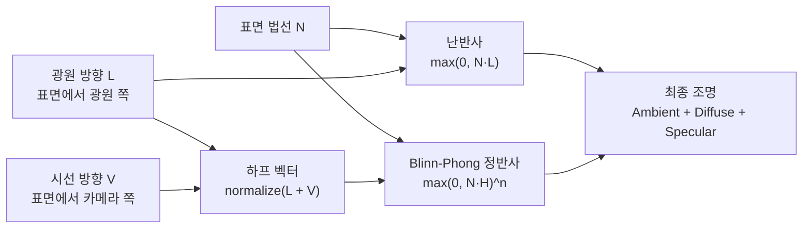
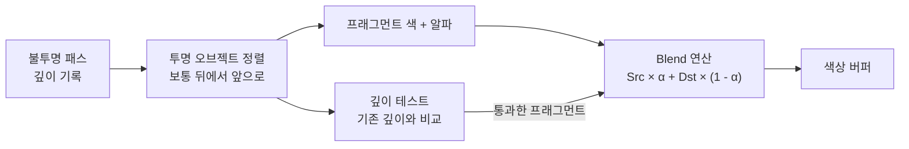
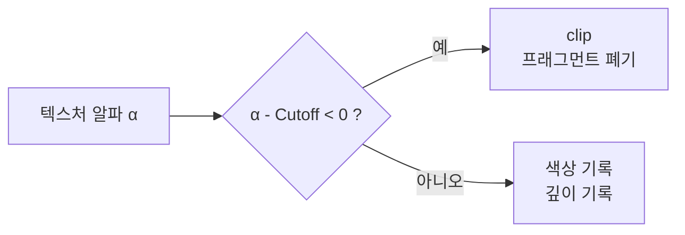
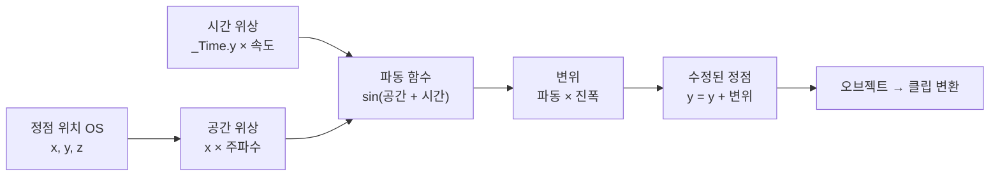

# Unity 셰이더: 조명, 블렌딩, 정점 애니메이션
이 문서는 Unity 셰이더 경로의 조명, 블렌딩, 정점 애니메이션 모듈을 다룹니다. 모듈은 개념의 순서일 뿐이며, 정해진 학습 기간은 없습니다.

> **따라 하기 환경**: Unity 2022.3 LTS + URP 14 (새 프로젝트 템플릿 `3D (URP)`). 셰이더는 `Project 창 → Create → Shader → Unlit Shader`(또는 Empty Shader)로 파일을 만들고 내용을 전부 붙여 넣은 뒤, 셰이더 우클릭 → Create → Material → 오브젝트에 적용합니다. 코드는 에디터에서 직접 컴파일해 검증하지 못했으므로 콘솔 에러가 나면 알려 주세요.

## 모듈 5: 기본 조명 모델

### Lambert, Phong, Blinn-Phong 모델과 코사인 관계

컴퓨터 그래픽스에서 Lambert, Phong, Blinn-Phong 모델은 표면의 빛 반사를 단순화해서 표현하는 대표적인 조명 모델입니다.  
아래에서 코사인과 벡터 내적 관점에서 연결하여 정리합니다.



모든 방향 벡터는 같은 좌표 공간에서 정규화해야 합니다. `N·L`은 빛이 표면을 향하는 정도를 결정하고, `N·H`는 하이라이트 세기를 결정합니다. Blinn-Phong의 지수 `n`이 클수록 하이라이트가 작고 선명해집니다. Blinn-Phong은 반사 벡터 대신 하프 벡터를 사용하는 모델이지만, 실제 성능 차이는 GPU와 컴파일 결과에 따라 달라져 항상 더 빠르다고 단정할 수 없습니다. 이 문서의 셰이더 예제는 URP 조명 방향을 사용하므로, 벡터의 부호와 공간을 섞지 않도록 주의하세요.

#### 1. Lambert 모델 (확산 반사)

- 식
```math
I_{diffuse} = k_d I_L \max(0, \mathbf{N}\cdot\mathbf{L})
```

* 벡터 관계
  $\mathbf{N}\cdot\mathbf{L} = \|\mathbf{N}\|\|\mathbf{L}\|\cos\theta = \cos\theta$ (단위벡터 기준)
* 설명: 표면 법선과 광원 방향 사이의 각도의 코사인이 밝기 결정
* 특징: 매트 표면, 하이라이트 없음

---

#### 2. Phong 모델 (정반사 포함)

* 식

```math
I = k_d I_L \max(0, \mathbf{N}\cdot\mathbf{L}) + k_s I_L \max(0, \mathbf{R}\cdot\mathbf{V})^n
```

* 벡터 관계

  * 확산: $\mathbf{N}\cdot\mathbf{L} = \cos\theta$ (Lambert와 동일)
  * 정반사: $\mathbf{R}\cdot\mathbf{V} = \cos\phi$, $\phi$ = 반사 벡터와 시선 벡터 사이 각
* 특징: 광택, 하이라이트 표현 가능
* 단점: $\mathbf{R}$ 계산 필요 → 계산량 증가

---

#### 3. Blinn-Phong 모델 (효율적인 정반사)

* Phong의 반사 벡터 대신 하프 벡터(Half Vector) 사용

$$
\mathbf{H} = \frac{\mathbf{L} + \mathbf{V}}{\|\mathbf{L} + \mathbf{V}\|}
$$

* 식:

```math
I_{specular} = k_s I_L \max(0, \mathbf{N}\cdot\mathbf{H})^n
```

* 벡터 관계

  * $\mathbf{N}\cdot\mathbf{H} = \cos\alpha$, $\alpha$ = 법선과 하프벡터 사이 각
  * 하프벡터는 시선과 광원의 중간 방향 → 법선과 반사 벡터가 이루는 각을 효율적으로 근사
* 장점

  * Phong과 비슷한 하이라이트를 더 적은 연산으로 구현 가능
  * $\mathbf{R}\cdot\mathbf{V}$ 계산 필요 없음 → 하프벡터 내적 한 번으로 충분

#### 실습: 법선과 시선으로 조명 결과 읽기

1. [Lambert + Blinn-Phong 예제](./조명-블렌딩-정점-애니메이션.md)에서 구 하나에 셰이더를 적용하고, 방향 광원이 비추는 상태를 기준으로 둡니다.
2. 광원 방향을 바꾸어 봅니다. 표면 법선과 광원 방향이 거의 나란한 면은 밝아지고, 서로 직각에 가까워지는 면은 어두워져야 합니다.
3. 카메라를 이동합니다. 난반사 명암은 대체로 유지되지만 정반사 하이라이트는 시선 방향에 따라 표면 위에서 움직입니다.
4. `Specular` 세기를 0으로 낮춰 하이라이트를 없앤 다음, 셰이더의 지수 값을 크게/작게 바꾸어 하이라이트 크기를 비교합니다.

**점검 질문**: 광원을 움직였을 때와 카메라를 움직였을 때 각각 어떤 항이 달라졌나요? 하이라이트가 움직이지 않는다면 정반사 계산에 표면→카메라 방향 `V`가 사용되는지, `N`, `L`, `V`가 같은 공간에 있는지 확인하세요.

---

#### 4. 비교 요약 (벡터 내적 / 코사인 관점)

| 모델          | 확산(diffuse)                              | 정반사(specular)                                  | 내적 / 코사인 사용 |
| ----------- | ---------------------------------------- | ---------------------------------------------- | ----------- |
| Lambert     | $\mathbf{N}\cdot\mathbf{L} = \cos\theta$ | 없음                                             | 법선-광원 각     |
| Phong       | $\mathbf{N}\cdot\mathbf{L} = \cos\theta$ | $(\mathbf{R}\cdot\mathbf{V})^n = \cos^n\phi$   | 반사-시선 각     |
| Blinn-Phong | $\mathbf{N}\cdot\mathbf{L} = \cos\theta$ | $(\mathbf{N}\cdot\mathbf{H})^n = \cos^n\alpha$ | 법선-하프벡터 각   |

---

#### 핵심 정리
1. Lambert → 단순 확산, 코사인 법칙 적용
2. Phong → 확산 + 정반사, 내적으로 시선-반사 벡터 각 표현
3. Blinn-Phong → Phong 정반사를 하프 벡터 내적으로 근사 → 연산 효율 ↑

---

`조명의 3요소`
컴퓨터 그래픽스에서 조명은 주로 세 가지 요소의 조합으로 표현됩니다.

`Ambient (환경광)`: 씬 전체에 고르게 퍼져 있는 빛입니다. 직접 빛을 받지 않는 어두운 부분(그림자)의 색상을 결정합니다.

`Diffuse (난반사)`: 빛이 표면에 부딪혀 모든 방향으로 고르게 반사되는 현상입니다. 표면의 각도에 따라 밝기가 달라지며, 물체의 기본 색상을 나타냅니다.

`Specular (정반사)`: 빛이 특정 방향으로 강하게 반사되는 현상입니다. 매끄러운 표면에서 하이라이트(반짝임)를 만듭니다.

`Dot(Normal, Light Direction)` 내적, 결과가 1이면 빛을 정면으로 받는 것이고, 0이면 90도로 비껴 맞는 것, 음수이면 뒷면을 향하는 것입니다.

`saturate() 함수`를 이용해 0과 1 사이의 값으로 만들어 빛의 감쇠량으로 사용합니다.

> 이 문서의 `SimpleLambert` 예제는 메인 방향 광원의 직접 난반사만 계산하며, 위에서 소개한 환경광 항은 포함하지 않습니다. 광원을 받지 않는 면이 검게 보이는 것은 이 예제의 의도된 단순화입니다.

#### 실습: Lambert 직접광 확인하기

1. URP 씬에 구와 방향 광원 하나를 두고 `SimpleLambert`를 적용합니다. 기본색을 흰색으로 두고 환경광을 추가하지 않은 기준 결과를 기록합니다.
2. 광원 방향을 바꾸어 표면 법선과 광원 방향이 나란한 면, 직각인 면, 반대 방향인 면의 밝기를 비교합니다. 셰이더의 `saturate(dot(N, L))`가 각각 1, 0, 0으로 제한되는 이유를 설명합니다.
3. 씬의 환경 조명 설정을 바꾸어도 이 코드의 결과가 직접광만으로 계산되는지 확인합니다. 환경광을 더하려면 별도 항을 구현해야 한다는 점을 기록합니다.

**완료 확인**: 방향 광원의 조명 방향과 `N·L`이 밝기를 결정하는 과정을 말할 수 있고, `SimpleLambert`가 환경광을 계산하지 않는다는 제한을 구분할 수 있습니다.

`법선 벡터 (Normal Vector)`
3D 모델의 각 정점(또는 면)이 바라보는 방향을 나타내는 단위 벡터입니다. 조명 계산의 핵심 요소로, 이 벡터가 있어야 빛과 표면의 각도를 계산할 수 있습니다. 법선 벡터는 보통 오브젝트 공간(Object Space)에 저장되어 있으므로, 조명 계산을 위해서는 월드 공간(World Space)으로 변환해야 합니다.


URP의 기본 방향 광원(Directional Light)을 기준으로 램버트 조명 모델을 구현하는 Unlit 셰이더 코드입니다. URP에서는 셰이더가 조명 정보를 자동으로 받기 위해 특정 규칙을 따라야 합니다.
```c
// 유니티 셰이더 파일: SimpleLambert.shader
Shader "MyShaders/SimpleLambert"
{
    Properties
    {
        _BaseColor ("Base Color", Color) = (1,1,1,1)
    }
    SubShader
    {
        // URP의 Lit 셰이더로 인식시키기 위한 태그
        Tags { "RenderPipeline" = "UniversalPipeline" "RenderType"="Opaque" }

        Pass
        {
            // URP의 조명 패스임을 명시
            Tags { "LightMode" = "UniversalForward" }

            HLSLPROGRAM
            #pragma vertex vert
            #pragma fragment frag

            #include "Packages/com.unity.render-pipelines.universal/ShaderLibrary/Core.hlsl"
            #include "Packages/com.unity.render-pipelines.universal/ShaderLibrary/Lighting.hlsl"

            struct Attributes
            {
                float4 positionOS   : POSITION;
                float3 normalOS     : NORMAL; // 정점의 법선 벡터 입력
            };

            struct Varyings
            {
                float4 positionHCS  : SV_POSITION;
                float3 normalWS     : TEXCOORD0; // 월드 공간 법선 벡터를 전달
            };

            CBUFFER_START(UnityPerMaterial)
                half4 _BaseColor;
            CBUFFER_END

            Varyings vert (Attributes IN)
            {
                Varyings OUT;
                OUT.positionHCS = TransformObjectToHClip(IN.positionOS.xyz);
                // 법선 벡터를 오브젝트 공간에서 월드 공간으로 변환
                OUT.normalWS = TransformObjectToWorldNormal(IN.normalOS);
                return OUT;
            }

            half4 frag (Varyings IN) : SV_Target
            {
                // 법선 벡터 정규화 (보간 과정에서 길이가 변할 수 있음)
                float3 normalWS = normalize(IN.normalWS);

                // URP에서 메인 광원 정보를 가져옴
                Light mainLight = GetMainLight();
                float3 lightDir = mainLight.direction;

                // 램버트 조명 계산: 내적 결과는 0 이하가 되지 않도록 saturate 처리
                half lambert = saturate(dot(normalWS, lightDir));

                // 최종 색상 = 기본색 * 난반사광 * 광원색 (이 예제에는 환경광(Ambient)이 없다)
                // mainLight.color는 빛의 색상과 강도를 포함
                half3 finalColor = _BaseColor.rgb * lambert * mainLight.color;

                return half4(finalColor, 1.0);
            }
            ENDHLSL
        }
    }
}
```

## 모듈 6: Blinn-Phong 조명과 고급 조명
 
`Blinn-Phong 조명 모델`
정반사(Specular)를 계산하여 하이라이트를 만드는 경험적 조명 모델입니다. 반사 벡터 대신 '절반 벡터(Halfway Vector)'를 사용해 하이라이트를 계산합니다. 연산량과 품질은 구현 및 플랫폼에 따라 달라지므로, Phong보다 항상 빠르다고 단정하지 않습니다.

`View Direction:` 표면에서 카메라(시점)를 향하는 벡터.

`Light Direction:` 표면에서 **광원을 향하는** 벡터. (URP 의 `mainLight.direction` 이 이 방향이며, 빛이 진행하는 방향의 반대입니다. 그래서 `dot(N, L)` 이 정면일 때 양수가 됩니다.)

`Halfway Vector:` View Direction과 Light Direction의 중간 벡터. normalize(viewDir + lightDir)로 계산합니다.

`pow(saturate(dot(normalWS, halfwayDir)), _Shininess)`: 법선과 절반 벡터가 얼마나 일치하는지를 계산하여 하이라이트의 강도를 결정합니다. _Shininess 값으로 반짝임의 집중도를 조절합니다.


5챕터 코드에 Blinn-Phong 정반사 계산을 추가한 코드입니다.
**파일: `Assets/Shaders/Lessons/BlinnPhong.shader`**
```hlsl
// 조명 모듈: Lambert + Blinn-Phong 스페큘러 (URP)
Shader "Lessons/BlinnPhong"
{
    Properties
    {
        _BaseColor ("Base Color", Color) = (1,1,1,1)
        _Shininess ("Shininess", Range(0.1, 100)) = 20
    }
    SubShader
    {
        Tags { "RenderPipeline"="UniversalPipeline" "RenderType"="Opaque" }
        Pass
        {
            Tags { "LightMode"="UniversalForward" }
            HLSLPROGRAM
            #pragma vertex vert
            #pragma fragment frag
            #include "Packages/com.unity.render-pipelines.universal/ShaderLibrary/Core.hlsl"
            #include "Packages/com.unity.render-pipelines.universal/ShaderLibrary/Lighting.hlsl"

            struct Attributes { float4 positionOS : POSITION; float3 normalOS : NORMAL; };
            struct Varyings   { float4 positionHCS : SV_POSITION; float3 normalWS : TEXCOORD0; float3 positionWS : TEXCOORD1; };

            CBUFFER_START(UnityPerMaterial)
                half4 _BaseColor;
                half  _Shininess;
            CBUFFER_END

            Varyings vert(Attributes IN)
            {
                Varyings OUT;
                OUT.positionWS  = TransformObjectToWorld(IN.positionOS.xyz);
                OUT.positionHCS = TransformWorldToHClip(OUT.positionWS);
                OUT.normalWS    = TransformObjectToWorldNormal(IN.normalOS);
                return OUT;
            }

            half4 frag(Varyings IN) : SV_Target
            {
                float3 N = normalize(IN.normalWS);
                Light light = GetMainLight();
                float3 L = light.direction;
                float3 V = GetWorldSpaceNormalizeViewDir(IN.positionWS);
                float3 H = normalize(L + V);

                half diffuse  = saturate(dot(N, L));
                half specular = pow(saturate(dot(N, H)), _Shininess) * step(0.0, diffuse);
                half3 color = (_BaseColor.rgb * diffuse + specular) * light.color;
                return half4(color, 1);
            }
            ENDHLSL
        }
    }
}
```

> 핵심: `H = normalize(L + V)`, `pow(saturate(dot(N,H)), _Shininess)`.

#### 실습: Blinn-Phong 하이라이트 조절하기

1. 같은 구와 방향 광원에서 `Lessons/BlinnPhong` 머티리얼을 적용하고 `_Shininess`를 `4`, `20`, `80`으로 바꿉니다. 값이 커질수록 하이라이트가 좁고 선명해지는지 비교합니다.
2. 광원을 움직여 확산 명암과 하이라이트 위치가 변하는지 확인한 뒤, 카메라를 움직여 정반사 하이라이트의 변화를 관찰합니다.
3. `_Shininess`를 낮은 값과 높은 값으로 비교해 결과를 기록합니다. 코드의 `step(0.0, diffuse)`는 광원이 표면 뒤쪽에 있을 때 정반사가 나오지 않도록 제한하는 용도입니다.
4. Lambert 실습과 같은 기본색·광원·장면을 사용해 두 결과를 비교합니다. 이 예제는 주변광, 그림자 수신, 추가 광원을 구현하지 않으므로 결과를 URP/Lit의 전체 조명과 동일하다고 보지 않습니다.

**완료 확인**: `L`과 `V`로 하프 벡터 `H`를 만드는 이유, `_Shininess`가 하이라이트 폭에 미치는 영향, 예제의 조명 범위를 설명할 수 있습니다. 성능 우열은 코드 모양만으로 결론 내리지 않고 목표 기기에서 측정합니다.

## 7챕터: 투명도와 블렌딩
`알파 블렌딩 (Alpha Blending)`
반투명 효과를 내는 기법입니다. 프래그먼트 셰이더가 계산한 색상의 알파(Alpha, 불투명도) 값을 이용해 배경색과 섞습니다.



투명 패스는 불투명 패스가 쓴 깊이와 비교해 가려진 프래그먼트를 걸러내지만, 보통 `ZWrite Off`로 투명 표면 자체의 깊이는 기록하지 않습니다. 이 때문에 투명 오브젝트끼리의 겹침은 정렬에 의존하고, 교차하는 메시나 한 오브젝트 안쪽 면 순서는 완벽하게 해결되지 않을 수 있습니다.

`"Queue"="Transparent"`: 렌더링 순서를 불투명 오브젝트들 뒤로 미룹니다. 투명 오브젝트는 뒤에 있는 것이 먼저 그려져야 올바르게 보입니다.

`ZWrite Off`: 깊이 버퍼(Z-Buffer)에 쓰기를 비활성화합니다. 깊이 테스트까지 끄는 설정은 아닙니다. 기존 불투명 오브젝트 뒤에 있는 투명 표면은 깊이 테스트에서 제외할 수 있지만, 투명 오브젝트끼리 서로의 깊이를 갱신하지 않아 뒤에서 앞으로 정렬하는 것이 중요합니다.

`Blend SrcAlpha OneMinusSrcAlpha`: 가장 일반적인 블렌딩 공식으로, (SourceColor * SourceAlpha) + (DestinationColor * (1 - SourceAlpha))를 의미합니다.

예를 들어 파란 배경 `(0, 0, 1)` 위에 알파가 `0.25`인 빨간색 `(1, 0, 0)`을 그리면 결과 RGB는 `(0.25, 0, 0.75)`가 됩니다. 알파는 불투명도를 뜻하며, 0은 완전히 투명하고 1은 완전히 불투명합니다.

`알파 테스팅` (Alpha Testing / Cutout)
텍스처의 알파 값이 특정 임계값(Threshold)보다 낮으면 해당 픽셀을 아예 그리지 않는 기법입니다. 나뭇잎, 철조망처럼 외곽선이 복잡한 오브젝트를 표현할 때 유용합니다. 투명 블렌딩과 달리 살아남은 픽셀은 깊이 기록을 할 수 있어 정렬 문제가 줄어들 수 있지만, 성능은 오버드로우·알파 테스트 비용·GPU에 따라 달라지므로 항상 더 저렴하다고 단정하지 않습니다.

`clip(value)`: HLSL 내장 함수로, value가 0보다 작으면 해당 프래그먼트의 렌더링을 중단합니다. 살아남은 프래그먼트는 불투명 표면처럼 깊이 버퍼에 기록될 수 있어, 컷아웃 재질은 투명 블렌딩과 달리 정렬 의존성이 적습니다.




1. 반투명 유리 셰이더
**파일: `Assets/Shaders/Lessons/TransparentGlass.shader`**
```hlsl
// 블렌딩 모듈: 알파 블렌딩 (반투명)
Shader "Lessons/TransparentGlass"
{
    Properties
    {
        _MainTex ("Texture", 2D) = "white" {}
        _Color ("Color", Color) = (1,1,1,0.5)
    }
    SubShader
    {
        Tags { "RenderPipeline"="UniversalPipeline" "Queue"="Transparent" "RenderType"="Transparent" }
        Pass
        {
            Tags { "LightMode"="UniversalForward" }
            ZWrite Off
            Blend SrcAlpha OneMinusSrcAlpha
            HLSLPROGRAM
            #pragma vertex vert
            #pragma fragment frag
            #include "Packages/com.unity.render-pipelines.universal/ShaderLibrary/Core.hlsl"

            struct Attributes { float4 positionOS : POSITION; float2 uv : TEXCOORD0; };
            struct Varyings   { float4 positionHCS : SV_POSITION; float2 uv : TEXCOORD0; };
            TEXTURE2D(_MainTex); SAMPLER(sampler_MainTex);
            CBUFFER_START(UnityPerMaterial)
                float4 _MainTex_ST;
                half4 _Color;
            CBUFFER_END

            Varyings vert(Attributes IN)
            {
                Varyings OUT;
                OUT.positionHCS = TransformObjectToHClip(IN.positionOS.xyz);
                OUT.uv = TRANSFORM_TEX(IN.uv, _MainTex);
                return OUT;
            }
            half4 frag(Varyings IN) : SV_Target
            {
                half4 tex = SAMPLE_TEXTURE2D(_MainTex, sampler_MainTex, IN.uv);
                return tex * _Color;
            }
            ENDHLSL
        }
    }
}
```

> 핵심: `Queue=Transparent`, `ZWrite Off`, `Blend SrcAlpha OneMinusSrcAlpha`. `_MainTex`의 색·알파에 `_Color`를 곱하므로, 머티리얼 색상의 A로 전체 투명도를 조절할 수 있습니다. 깊이 테스트는 기본 상태로 유지됩니다.
2. Cutout 셰이더
**파일: `Assets/Shaders/Lessons/AlphaCutout.shader`**
```hlsl
// 블렌딩 모듈: 알파 테스트 (clip) - 투명한 픽셀을 버린다
Shader "Lessons/AlphaCutout"
{
    Properties
    {
        _MainTex ("Texture", 2D) = "white" {}
        _Cutoff ("Alpha Cutoff", Range(0,1)) = 0.5
    }
    SubShader
    {
        Tags { "RenderPipeline"="UniversalPipeline" "RenderType"="TransparentCutout" "Queue"="AlphaTest" }
        Pass
        {
            Tags { "LightMode"="UniversalForward" }
            Cull Off
            HLSLPROGRAM
            #pragma vertex vert
            #pragma fragment frag
            #include "Packages/com.unity.render-pipelines.universal/ShaderLibrary/Core.hlsl"

            struct Attributes { float4 positionOS : POSITION; float2 uv : TEXCOORD0; };
            struct Varyings   { float4 positionHCS : SV_POSITION; float2 uv : TEXCOORD0; };
            TEXTURE2D(_MainTex); SAMPLER(sampler_MainTex);
            CBUFFER_START(UnityPerMaterial)
                float4 _MainTex_ST;
                half _Cutoff;
            CBUFFER_END

            Varyings vert(Attributes IN)
            {
                Varyings OUT;
                OUT.positionHCS = TransformObjectToHClip(IN.positionOS.xyz);
                OUT.uv = TRANSFORM_TEX(IN.uv, _MainTex);
                return OUT;
            }
            half4 frag(Varyings IN) : SV_Target
            {
                half4 tex = SAMPLE_TEXTURE2D(_MainTex, sampler_MainTex, IN.uv);
                clip(tex.a - _Cutoff);
                return tex;
            }
            ENDHLSL
        }
    }
}
```

> 핵심: `clip(tex.a - _Cutoff)`. 알파가 있는 PNG(예: 나뭇잎)를 _MainTex 에 넣어 테스트하세요.

#### 실습: 투명 블렌딩과 컷아웃 비교

1. 같은 알파 PNG를 `TransparentGlass`와 `AlphaCutout` 각각의 `_MainTex`에 적용합니다. 텍스처 알파가 적용되는지 확인하기 위해 흰색 `_Color`를 기준으로 시작합니다.
2. 투명 머티리얼은 알파를 `0.25`, `0.5`, `0.75`로 바꾸며 배경이 얼마나 비치는지 비교합니다. 위 공식에 배경색과 셰이더 색을 대입해 출력 색을 예측한 뒤 화면과 대조합니다.
3. 컷아웃 머티리얼은 `_Cutoff`를 `0.2`에서 `0.8`까지 높입니다. 남는 픽셀이 줄어들며 경계가 날카롭게 바뀌는지 확인합니다.
4. 두 오브젝트를 겹치고 카메라를 회전합니다. 투명 표면이 잘못 겹쳐 보일 때는 카메라와의 정렬, `ZWrite`, 메시의 앞·뒷면을 확인합니다. 컷아웃은 `clip` 경계가 선명하지만 투명 블렌딩처럼 배경이 비치지는 않습니다.

**완료 확인**: 같은 텍스처에서 블렌딩은 픽셀 색을 배경과 섞고 컷아웃은 임계값 아래 픽셀을 버리는 차이를 설명할 수 있습니다. 투명 머티리얼이 기존 불투명 깊이와 테스트하지만 기본적으로 깊이를 기록하지 않는 점, 컷아웃은 통과한 픽셀의 깊이를 기록할 수 있는 점도 확인합니다.

## 8챕터: 정점 셰이더 활용

`정점 위치 조작`
지금까지 정점 셰이더(vert)는 정점의 위치를 좌표 공간 변환만 했습니다. 하지만 정점의 위치(positionOS)를 변환하기 전에 직접 수정하면 오브젝트의 형태를 동적으로 바꿀 수 있습니다.
`
_Time 변수`
유니티가 셰이더에 자동으로 제공하는 내장 변수로, 시간의 흐름에 따른 값을 담고 있습니다. _Time.y가 일반적으로 사용되는 시간 값(Time.time)입니다. 이를 sin, cos 같은 삼각함수와 조합하면 주기적인 움직임을 쉽게 만들 수 있습니다.



공간 항이 없고 시간만 파동에 넣으면 모든 정점이 같은 양만큼 움직여 물체 전체가 위아래로 이동합니다. 위치에 따른 공간 항을 더하면 정점마다 위상이 달라져 물결이 생깁니다. 진폭은 최대 이동량, 주파수는 공간상 물결의 간격, 속도는 시간에 따른 진행 속도를 조절합니다. 아래 셰이더는 텍스처 기반 노이즈 변형은 구현하지 않고, X축을 따라 진행하는 단순한 사인파만 보여줍니다.

`과제 가이드`
바람에 흔들리는 깃발처럼 평면(Plane)을 위아래로 출렁이게 하는 셰이더 코드입니다.
**파일: `Assets/Shaders/Lessons/WavingFlag.shader`**
```hlsl
// 정점 애니메이션 모듈: _Time 으로 정점을 흔든다. Plane 이나 Quad 에 적용하면 잘 보인다.
Shader "Lessons/WavingFlag"
{
    Properties
    {
        _MainTex ("Texture", 2D) = "white" {}
        _WaveFrequency ("Wave Frequency", Range(0, 10)) = 3
        _WaveSpeed ("Wave Speed", Float) = 1
        _WaveHeight ("Wave Height", Float) = 0.1
    }
    SubShader
    {
        Tags { "RenderPipeline"="UniversalPipeline" "RenderType"="Opaque" }
        Pass
        {
            Tags { "LightMode"="UniversalForward" }
            Cull Off
            HLSLPROGRAM
            #pragma vertex vert
            #pragma fragment frag
            #include "Packages/com.unity.render-pipelines.universal/ShaderLibrary/Core.hlsl"

            struct Attributes { float4 positionOS : POSITION; float2 uv : TEXCOORD0; };
            struct Varyings   { float4 positionHCS : SV_POSITION; float2 uv : TEXCOORD0; };
            TEXTURE2D(_MainTex); SAMPLER(sampler_MainTex);
            CBUFFER_START(UnityPerMaterial)
                float4 _MainTex_ST;
                half _WaveFrequency;
                half _WaveSpeed;
                half _WaveHeight;
            CBUFFER_END

            Varyings vert(Attributes IN)
            {
                Varyings OUT;
                float3 pos = IN.positionOS.xyz;
                pos.y += sin(pos.x * _WaveFrequency + _Time.y * _WaveSpeed) * _WaveHeight;
                OUT.positionHCS = TransformObjectToHClip(pos);
                OUT.uv = TRANSFORM_TEX(IN.uv, _MainTex);
                return OUT;
            }
            half4 frag(Varyings IN) : SV_Target { return SAMPLE_TEXTURE2D(_MainTex, sampler_MainTex, IN.uv); }
            ENDHLSL
        }
    }
}
```

> 핵심: 변환 *전에* 정점 위치를 `sin(x * frequency + _Time.y * speed)`로 수정합니다. Plane/Quad에 적용하세요. 메시가 성기면 파동이 각져 보일 수 있습니다.

#### 실습: 파동 간격·진폭·속도 관찰하기

1. 충분히 분할된 Plane에 셰이더를 적용하고, 먼저 `_WaveHeight`를 `0`으로 설정합니다. 변위가 사라지는 기준 결과를 기록합니다.
2. `_WaveHeight`만 `0.05`, `0.1`, `0.25`로 바꾸어 수직 변위의 크기를 비교합니다.
3. `_WaveFrequency`를 `1`, `3`, `6`으로 바꾸어 화면에 나타나는 물결의 간격을 비교합니다. 주파수가 높아지면 같은 메시 구간에 더 많은 파동이 생깁니다.
4. `_WaveSpeed`를 `0`, `1`, `3`으로 바꾸고 같은 카메라에서 파동의 시간상 진행 속도를 확인합니다. `_WaveSpeed`가 `0`이면 시간에 따라 위상이 변하지 않습니다.
5. 메시 분할 수가 다른 두 Plane에서 같은 파라미터를 비교합니다. 정점 수가 부족하면 셰이더가 새 정점을 만들지 않으므로 파동 곡선이 각져 보입니다.

**완료 확인**: 공간 위상 `x * _WaveFrequency`가 파동 간격을, `_Time.y * _WaveSpeed`가 시간상 진행을, `_WaveHeight`가 최대 변위 크기를 조절함을 설명할 수 있습니다. 이 예제가 노이즈 기반 바람이나 실제 물리 시뮬레이션은 아니라는 범위도 구분합니다.
