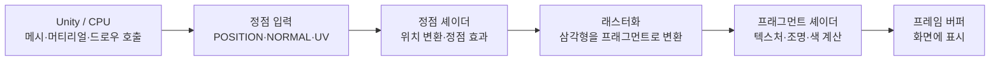

## Unity 셰이더 학습 경로

이 경로는 렌더링 파이프라인의 기초부터 고급 셰이더 기법까지 다룹니다. 단계는 개념 의존 관계를 보여 주는 자기 주도형 모듈이며, 주차나 학습 기간을 정하지 않습니다. 학습자는 Unity 프로젝트에서 셰이더 효과를 직접 만들고, 마지막에는 여러 기법을 조합한 시각 효과를 완성합니다.

### 렌더링 흐름 한눈에 보기

**읽는 방법**: 정점 셰이더의 출력은 래스터화 과정에서 픽셀 후보인 프래그먼트로 보간됩니다. 프래그먼트 셰이더는 각 프래그먼트의 텍스처와 조명을 계산합니다. 실제 적용 가능한 함수와 입력 구조는 렌더 파이프라인(이 저장소의 실습은 URP)에 따라 달라집니다.

### 권장 순서

1. [기초: ShaderLab, HLSL, 좌표, 텍스처](./셰이더-기초-ShaderLab-HLSL-좌표-텍스처.md)
2. [조명, 블렌딩, 정점 애니메이션](./조명-블렌딩-정점-애니메이션.md)
3. [노멀 매핑, 프레넬, 디졸브](./노멀-매핑-프레넬-디졸브.md)
4. [후처리, 컴퓨트, 최적화, 프로젝트](./후처리-컴퓨트-최적화-프로젝트.md)

새 기법을 구현하기 전에는 작은 장면에서 먼저 확인하고, 완성 기준은 각 모듈의 과제를 통해 점검하세요.

### 학습 완료 기준

- URP 프로젝트에서 셰이더를 만들고 머티리얼에 적용해 원하는 효과를 재현할 수 있습니다.
- 좌표 공간, 법선, 조명 입력이 결과에 미치는 영향을 설명하고 직접 조절할 수 있습니다.
- 최종 프로젝트에서 두 가지 이상의 학습 기법을 결합하고, Frame Debugger로 렌더링 과정을 확인합니다.

## 목표

컴퓨터 그래픽스와 렌더링 파이프라인의 동작 원리 이해

유니티 셰이더의 구조와 ShaderLab, HLSL/Cg 프로그래밍 능력 습득

조명, 텍스처, 정점(Vertex) 조작을 통해 다양한 시각 효과 구현

셰이더 그래프와 코드 셰이더의 장단점을 이해하고 활용

셰이더 최적화 및 디버깅 능력 함양

## 추천 대상

유니티 엔진 사용 경험이 있는 개발자

셰이더 코드를 직접 작성하여 커스텀 재질이나 효과를 만들고 싶은 분

그래픽스 파이프라인에 대한 깊은 이해를 원하는 분

## 모듈 1: 렌더링 파이프라인과 셰이더의 기초
1: 그래픽스 파이프라인 입문

셰이더란 무엇인가? GPU와 CPU의 역할 차이

렌더링 파이프라인의 전체 흐름 (Application → Vertex → Rasterization → Fragment)

정점(Vertex), 폴리곤(Polygon), 픽셀/프래그먼트(Pixel/Fragment)의 개념

유니티의 렌더링 파이프라인 종류: Built-in, URP, HDRP

과제: URP(Universal Render Pipeline)로 프로젝트를 생성하고, 렌더링 파이프라인 에셋을 설정해보기

실습 자료: [ShaderLab 기초와 좌표·텍스처](./셰이더-기초-ShaderLab-HLSL-좌표-텍스처.md)의 1절. Graphics 설정에 URP 에셋이 지정되어 있고 URP 템플릿 프로젝트가 실행되는지 확인합니다.

## 모듈 2: 첫 셰이더와 ShaderLab

유니티 셰이더 파일(.shader)의 기본 구조 분석

ShaderLab 구문 이해: Properties, SubShader, Pass, Tags

가장 간단한 형태의 'Unlit Shader' 직접 작성하기

Properties 블록을 통해 인스펙터에서 셰이더 속성(색상, 숫자 등) 제어하기

과제: 오브젝트의 색상을 인스펙터에서 지정한 색상으로 칠하는 간단한 셰이더 만들기

실습 자료: [ShaderLab 기초와 좌표·텍스처](./셰이더-기초-ShaderLab-HLSL-좌표-텍스처.md)의 「첫 셰이더와 ShaderLab」 전체 `SimpleColor` 예제. `_MyColor`를 바꾸었을 때 머티리얼 색이 바뀌고 셰이더 오류가 없는지 확인합니다.

## 모듈 3: HLSL 기초와 좌표 공간

HLSL(High-Level Shading Language) 프로그래밍 기초

주요 데이터 타입: float, half, 벡터(float4), 행렬(float4x4). URP HLSL에서는 `fixed`를 사용하지 않으며 정밀도와 성능은 대상 플랫폼에서 확인

정점 셰이더와 프래그먼트 셰이더의 역할

정점 셰이더의 입출력 구조체(appdata, v2f)

좌표 공간 변환의 이해: 오브젝트(로컬) 공간 → 월드 공간 → 뷰 공간 → 클립 공간

과제: URP의 `TransformObjectToHClip`을 사용해 정점 위치를 클립 공간으로 변환하는 코드 분석하기

실습 자료: [ShaderLab 기초와 좌표·텍스처](./셰이더-기초-ShaderLab-HLSL-좌표-텍스처.md)의 「HLSL 기초와 좌표 공간」. 오브젝트를 이동·회전하고 오브젝트 공간과 월드 공간의 차이를 확인합니다. `UNITY_MATRIX_MVP`는 Built-in 예제의 레거시 표현으로 구분합니다.

## 모듈 4: 텍스처와 UV 매핑

텍스처(Texture)를 셰이더로 가져와 사용하는 방법

UV 좌표의 개념과 역할

HLSL에서 텍스처 샘플링하기: tex2D 함수

텍스처 Tiling(타일링)과 Offset(오프셋) 구현하기

과제: 텍스처를 입히고, 인스펙터에서 Tiling/Offset 값을 조절하여 텍스처가 움직이거나 반복되도록 만들기

실습 자료: [ShaderLab 기초와 좌표·텍스처](./셰이더-기초-ShaderLab-HLSL-좌표-텍스처.md)의 「텍스처와 UV 매핑」 전체 `SimpleTexture` 예제. UV `(0.3, 0.4)`, Tiling `(2, 1)`, Offset `(0.1, 0)`의 샘플 위치 `(0.7, 0.4)`를 계산하고 Repeat와 Clamp 결과를 비교합니다.

## 조명과 중급 셰이더 기법
## 모듈 5: 기본 조명 모델

빛의 3요소: Ambient(환경광), Diffuse(난반사), Specular(정반사)

램버트(Lambert) 조명 모델의 원리

법선 벡터(Normal Vector)의 역할과 조명 계산에서의 중요성

내적(Dot Product)을 이용한 빛의 감쇠 계산

과제: 방향 광원(Directional Light) 하나를 기준으로 램버트 조명을 직접 계산하는 셰이더 만들기

실습 자료: [조명·블렌딩·정점 애니메이션](./조명-블렌딩-정점-애니메이션.md)의 모듈 5. `SimpleLambert`는 직접광만 계산하므로, 조명을 받지 않는 면과 `N·L` 값의 관계를 비교합니다.

## 모듈 6: Blinn-Phong 조명과 고급 조명

Blinn-Phong 조명 모델의 원리 (Specular 하이라이트 구현)

View Direction, Light Direction, Half Vector 계산법

URP에서 제공하는 조명 관련 데이터에 접근하는 방법

그림자(Shadow)가 적용되는 원리

과제: Blinn-Phong 모델을 구현하여 반짝이는 재질 셰이더 만들기

실습 자료: [조명·블렌딩·정점 애니메이션](./조명-블렌딩-정점-애니메이션.md)의 모듈 6. `_Shininess`와 광원·카메라 방향을 바꾸어 하이라이트를 확인합니다. 성능 우위는 대상 플랫폼에서 별도 측정합니다.

## 모듈 7: 투명도와 블렌딩

알파 블렌딩(Alpha Blending)과 알파 테스팅(Alpha Testing/Cutout)의 차이

Tags를 이용한 렌더링 순서 제어 ("Queue"="Transparent")

ZWrite와 ZTest의 역할: 투명 표면은 깊이 테스트를 유지하면서 깊이 기록은 끄는 이유

ShaderLab의 Blend 명령어 사용법 (Blend SrcAlpha OneMinusSrcAlpha)

과제: 반투명 유리 효과 셰이더와, 텍스처의 알파값을 기준으로 외곽선을 잘라내는 Cutout 셰이더 만들기

실습 자료: [조명·블렌딩·정점 애니메이션](./조명-블렌딩-정점-애니메이션.md)의 모듈 7. 같은 알파 텍스처를 두 셰이더에 적용해 머티리얼 알파 블렌딩과 `_Cutoff` 컷아웃, 깊이 동작을 비교합니다.

## 모듈 8: 정점 셰이더 활용

정점 셰이더에서 정점의 위치(Position) 조작하기

_Time 변수를 활용하여 애니메이션 구현

Sine/Cosine 함수를 이용한 깃발, 풀잎 흔들림 효과 만들기

노이즈(Noise) 텍스처를 활용한 불규칙한 움직임 표현

과제: 바람에 흔들리는 풀이나 천과 같은 움직임을 표현하는 셰이더 만들기

실습 자료: [조명·블렌딩·정점 애니메이션](./조명-블렌딩-정점-애니메이션.md)의 모듈 8. 메시 분할 수와 `_WaveHeight`, `_WaveFrequency`, `_WaveSpeed`를 각각 바꾸어 파동 형태와 진행을 확인합니다. 예제는 사인파 기반이며 노이즈 변형은 포함하지 않습니다.

## 고급 셰이더 이펙트
## 모듈 9: 노멀 매핑과 고급 텍스처

노멀 맵(Normal Map)의 원리와 표면 디테일 추가 방법

탄젠트 공간(Tangent Space)의 이해

노멀 맵 샘플링 및 조명 계산에 적용하기

기타 PBR 맵 소개: Metallic, Smoothness, Ambient Occlusion

과제: 평평한 폴리곤에 노멀 맵을 적용하여 울퉁불퉁한 표면처럼 보이게 만들기

실습 자료: [노멀 매핑·프레넬·디졸브](./노멀-매핑-프레넬-디졸브.md)의 모듈 9. Texture Type을 Normal map으로 설정하고 `_NormalScale`과 광원 방향을 바꾸어 음영 변화를 확인합니다.

## 모듈 10: 프레넬과 림 라이팅

프레넬(Fresnel) 효과의 원리: 시선과 표면이 이루는 각도에 따른 반사율 변화

법선 벡터와 시선 벡터의 내적을 이용한 프레넬 계산

림 라이팅(Rim Lighting) 구현하기

에너지 쉴드, 물 표면 등 활용 사례

과제: 오브젝트의 외곽선이 빛나는 듯한 림 라이팅 효과 셰이더 만들기

실습 자료: [노멀 매핑·프레넬·디졸브](./노멀-매핑-프레넬-디졸브.md)의 모듈 10. 카메라 각도와 `_RimPower`를 바꾸며 림 영역을 비교합니다.

## 모듈 11: 디졸브 및 왜곡 효과

clip() 함수를 이용한 픽셀 단위 제거

노이즈 텍스처, `clip()`과 `smoothstep()`을 활용한 디졸브(Dissolve)/번(Burn) 효과 구현

화면 배경을 샘플링하는 굴절 효과의 개념 (URP에서는 Opaque Texture와 `SampleSceneColor` 사용; `GrabPass`는 Built-in 경로)

간단한 유리, 물방울 왜곡 효과 구현

과제: 기준 값(Threshold)에 따라 오브젝트가 타들어가며 사라지는 디졸브 셰이더 만들기

실습 자료: [노멀 매핑·프레넬·디졸브](./노멀-매핑-프레넬-디졸브.md)의 모듈 11. 노이즈 타일링, 임계값, 번 가장자리 폭을 각각 바꾸어 확인합니다. 배경 왜곡 코드는 아직 별도 예제가 없습니다.

## 모듈 12: 셰이더 그래프 (Shader Graph)

노드 기반 셰이더 편집기 '셰이더 그래프' 소개

코드로 작성했던 셰이더들을 셰이더 그래프로 재구성하기

셰이더 그래프의 장단점과 코드 셰이더와의 차이

Custom Function 노드를 통해 HLSL 코드와 통합하기

과제: 이전에 만들었던 셰이더 중 하나를 셰이더 그래프로 똑같이 구현해보기

실습 자료: [노멀 매핑·프레넬·디졸브](./노멀-매핑-프레넬-디졸브.md)의 모듈 12. 림 라이팅 그래프를 구성하고 코드 셰이더와 좌표 공간·결과를 비교합니다.

## 실전과 심화
## 모듈 13: 포스트 프로세싱 (Post-processing)

화면 전체를 대상으로 하는 포스트 프로세싱과 메시 셰이더의 차이

URP Renderer Feature/Pass를 사용한 카메라 색상 처리와 임시 텍스처

그레이스케일 강도 조절 및 렌더 패스 시점 확인

과제: 화면 가장자리가 어두워지는 비네트(Vignette) 효과를 포스트 프로세싱으로 만들기

실습 자료: [후처리·컴퓨트·최적화·프로젝트](./후처리-컴퓨트-최적화-프로젝트.md)의 모듈 13. Unity 2022.3 LTS와 URP 14 기준이며, Renderer Feature 설정 및 `_Intensity` 변화부터 확인합니다.

## 모듈 14: 컴퓨트 셰이더 (Compute Shader) 입문

GPGPU(General-Purpose computing on GPU)의 개념

렌더링이 아닌, 대규모 병렬 연산을 위한 컴퓨트 셰이더의 역할

파티클 시스템, 유체 시뮬레이션 등 활용 사례

C# 스크립트에서 컴퓨트 셰이더를 실행하고 데이터 주고받기

과제: 수만 개의 파티클 위치를 컴퓨트 셰이더로 동시에 계산하고 업데이트하는 간단한 예제 구현

실습 자료: [후처리·컴퓨트·최적화·프로젝트](./후처리-컴퓨트-최적화-프로젝트.md)의 모듈 14. 파티클 수 `10003`과 그룹 크기 `64`를 사용해 Dispatch 경계 검사 및 C#/HLSL 버퍼 계약을 확인합니다.

## 모듈 15: 셰이더 최적화와 디버깅

셰이더 성능에 영향을 미치는 요소들 (연산 복잡도, 텍스처 접근, 분기문 등)

유니티 프레임 디버거(Frame Debugger)를 이용한 렌더링 과정 분석

셰이더 키워드와 multi_compile을 이용한 동적 기능 제어

셰이더 LOD(Level of Detail) 기법

과제: 복잡한 연산을 가진 셰이더를 프레임 디버거로 분석하고, 불필요한 연산을 줄여 성능 개선하기

실습 자료: [후처리·컴퓨트·최적화·프로젝트](./후처리-컴퓨트-최적화-프로젝트.md)의 모듈 15. Frame Debugger로 이벤트를 살피고 GPU 프로파일러로 시간을 확인한 뒤, 변경 전후를 같은 조건에서 비교합니다.

## 모듈 16: 프로젝트

* 지금까지 배운 모든 기법을 종합하여 자신만의 독창적인 시각 효과 만들기

* 프로젝트 아이디어 예시

* 스타일라이즈드(Toon) 캐릭터 렌더링 셰이더 (외곽선 포함)

* 상호작용이 가능한 물 표면 셰이더 (파문, 굴절, 프레넬 효과)

* 공상과학(Sci-fi) 홀로그램 또는 에너지 쉴드 이펙트

* 절차적으로 생성되는 지형 셰이더

* 기획을 완성하여 포트폴리오로 정리하기

통합 프로젝트 예시와 완료 기준: [후처리·컴퓨트·최적화·프로젝트](./후처리-컴퓨트-최적화-프로젝트.md)의 모듈 16. 충돌 입력, 월드 공간 파동 변위, 림 효과를 단계별로 구현하고 결과 및 환경을 기록합니다.