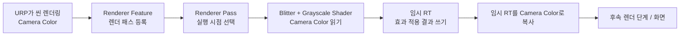
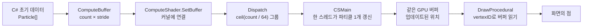
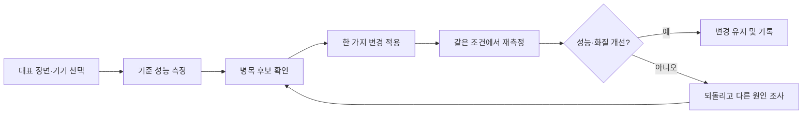
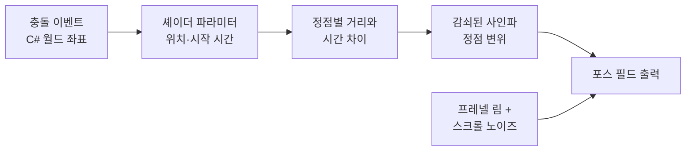

## Unity 셰이더: 후처리, 컴퓨트, 최적화, 프로젝트
이 문서는 Unity 셰이더 경로의 후처리, 컴퓨트 셰이더, 최적화, 통합 프로젝트를 다룹니다. 모듈은 개념의 순서일 뿐이며, 정해진 학습 기간은 없습니다.

> **따라 하기 환경**: Unity 2022.3 LTS + URP 14 (새 프로젝트 템플릿 `3D (URP)`). 이 문서의 코드는 URP 14 기준이며 Unity 6(URP 17)에서는 후처리 모듈의 Renderer Feature 코드가 그대로 동작하지 않습니다. 코드는 직접 에디터에서 컴파일해 검증하지 못했으므로 콘솔 에러가 나면 코드와 에러 메시지를 대조해 보세요.

## 모듈 13: 포스트 프로세싱 (Post-processing)

`포스트 프로세싱이란?`
전체 씬이 렌더링된 후, 최종 화면 이미지를 대상으로 한 번 더 셰이더를 적용하여 화면 전체에 특수 효과를 주는 기법입니다. 블룸(Bloom), 색 보정(Color Grading), 비네트(Vignette) 등이 대표적인 예입니다.

`URP에서의 구현`: Renderer Feature와 Blit
URP에서는 Renderer Feature라는 스크립터블(Scriptable) 클래스를 통해 렌더링 파이프라인에 커스텀 렌더링 패스를 쉽게 추가할 수 있습니다.

`ScriptableRendererFeature`: 렌더링 패스를 관리하는 C# 스크립트. URP 에셋의 Renderer에 추가하여 사용합니다.

`ScriptableRenderPass`: 실제 렌더링 작업을 정의하는 C# 스크립트.

`Blit`: 한 텍스처의 내용을 다른 텍스처로 복사하는 작업입니다. 포스트 프로세싱에서는 '원본 화면 텍스처'를 '커스텀 셰이더를 적용한 임시 텍스처'로, 다시 '최종 화면'으로 복사하는 과정을 거칩니다.



**왜 임시 텍스처를 쓸까요?** 셰이더가 읽는 소스와 쓰는 렌더 타깃이 같은 텍스처이면 읽기·쓰기 충돌이 생길 수 있습니다. 이 예제는 카메라 색상을 임시 RT로 변환한 다음, 그 결과를 카메라 색상으로 복사합니다. `Renderer Feature`는 패스를 등록하고, `Renderer Pass`는 실제 복사 작업과 실행 시점을 담당합니다.


화면 전체를 흑백으로 만드는 간단한 그레이스케일(Grayscale) 포스트 프로세싱 효과를 만들어봅니다.

1. 그레이스케일 셰이더 (PostGrayscale.shader)
**파일: `Assets/Shaders/PostProcess/PostGrayscale.shader`**
```hlsl
// Part 4 : 전체 화면 그레이스케일. GrayscaleFeature.cs 가 Blitter 로 호출한다. (URP 14 / Unity 2022.3)
// 일반 메시에 적용하는 셰이더가 아니다. Blit.hlsl 의 Vert 가 화면 전체 삼각형을 만든다.
Shader "Hidden/PostProcess/Grayscale"
{
    Properties
    {
        _Intensity ("Intensity", Range(0,1)) = 1
    }
    SubShader
    {
        Tags { "RenderPipeline"="UniversalPipeline" }
        ZWrite Off ZTest Always Cull Off
        Pass
        {
            Name "Grayscale"
            HLSLPROGRAM
            #pragma vertex Vert
            #pragma fragment Frag
            #include "Packages/com.unity.render-pipelines.universal/ShaderLibrary/Core.hlsl"
            #include "Packages/com.unity.render-pipelines.core/Runtime/Utilities/Blit.hlsl"

            half _Intensity;

            half4 Frag(Varyings input) : SV_Target
            {
                UNITY_SETUP_STEREO_EYE_INDEX_POST_VERTEX(input);
                half4 color = SAMPLE_TEXTURE2D_X(_BlitTexture, sampler_LinearClamp, input.texcoord);
                half gray = dot(color.rgb, half3(0.299, 0.587, 0.114));
                return half4(lerp(color.rgb, gray.xxx, _Intensity), color.a);
            }
            ENDHLSL
        }
    }
}
```

> 전체 화면용 셰이더입니다(`Blit.hlsl` 의 `Vert` 사용). 일반 메시의 `TransformObjectToHClip` 방식으로는 화면 전체가 그려지지 않습니다.

2. C# 스크립트 (GrayscaleFeature.cs)
이 스크립트를 생성하여 URP Renderer 에셋에 추가해야 합니다.
**파일: `Assets/Scripts/PostProcess/GrayscaleFeature.cs`**
```csharp
using UnityEngine;
using UnityEngine.Rendering;
using UnityEngine.Rendering.Universal;

namespace ShaderStudy.PostProcess
{
    /// <summary>
    /// URP 14(Unity 2022.3) 용 Renderer Feature. 카메라 컬러를 임시 RT 에 그레이스케일로 복사한 뒤 되돌려 쓴다.
    /// "같은 텍스처를 읽으면서 동시에 쓰는" 것은 불가능하므로 임시 RT 를 거친다.
    /// 주의: Unity 6(URP 17)의 RenderGraph 에서는 이 API 가 그대로 동작하지 않는다.
    /// </summary>
    public class GrayscaleFeature : ScriptableRendererFeature
    {
        [System.Serializable]
        public class Settings
        {
            public Shader shader;
            [Range(0f, 1f)] public float intensity = 1f;
            public RenderPassEvent renderPassEvent = RenderPassEvent.AfterRenderingPostProcessing;
        }

        public Settings settings = new Settings();
        Material material;
        GrayscalePass pass;

        public override void Create()
        {
            if (settings.shader == null) return;
            material = CoreUtils.CreateEngineMaterial(settings.shader);
            pass = new GrayscalePass(material) { renderPassEvent = settings.renderPassEvent };
        }

        public override void AddRenderPasses(ScriptableRenderer renderer, ref RenderingData renderingData)
        {
            if (pass == null) return;
            if (renderingData.cameraData.cameraType != CameraType.Game) return;
            material.SetFloat("_Intensity", settings.intensity);
            renderer.EnqueuePass(pass);
        }

        public override void SetupRenderPasses(ScriptableRenderer renderer, in RenderingData renderingData)
        {
            // cameraColorTargetHandle 은 AddRenderPasses 시점에는 쓸 수 없고 여기서 접근해야 한다.
            pass?.Setup(renderer.cameraColorTargetHandle);
        }

        protected override void Dispose(bool disposing)
        {
            pass?.Dispose();
            CoreUtils.Destroy(material);
        }

        class GrayscalePass : ScriptableRenderPass
        {
            readonly Material material;
            RTHandle source;
            RTHandle temp;

            public GrayscalePass(Material material) { this.material = material; }
            public void Setup(RTHandle source) { this.source = source; }

            public override void OnCameraSetup(CommandBuffer cmd, ref RenderingData renderingData)
            {
                var desc = renderingData.cameraData.cameraTargetDescriptor;
                desc.depthBufferBits = 0;
                RenderingUtils.ReAllocateIfNeeded(ref temp, desc, name: "_GrayscaleTemp");
            }

            public override void Execute(ScriptableRenderContext context, ref RenderingData renderingData)
            {
                var cmd = CommandBufferPool.Get("Grayscale");
                Blitter.BlitCameraTexture(cmd, source, temp, material, 0); // source -> temp (셰이더 적용)
                Blitter.BlitCameraTexture(cmd, temp, source);              // temp -> source (복사)
                context.ExecuteCommandBuffer(cmd);
                CommandBufferPool.Release(cmd);
            }

            public void Dispose() { temp?.Release(); }
        }
    }
}
```

> 설정: URP Renderer 에셋 → Add Renderer Feature → Grayscale Feature → Shader 슬롯에 `Hidden/PostProcess/Grayscale` 셰이더 지정. **Unity 2022.3(URP 14) 전용**입니다.

#### 실습: 강도와 렌더 패스 시점 확인하기

1. Unity 2022.3 LTS와 URP 14 프로젝트에서 카메라가 사용하는 Renderer 에셋을 확인하고, 위 `GrayscaleFeature`를 Renderer Feature로 추가합니다. Shader 슬롯에 `Hidden/PostProcess/Grayscale`을 지정합니다.
2. Game 카메라로 장면을 실행하고 `_Intensity`를 `0`, `0.5`, `1`로 바꿉니다. `0`은 원본, `1`은 완전한 그레이스케일이며 중간값은 원본과 회색 결과를 선형 보간합니다.
3. 프레임 디버거에서 해당 패스가 실행되는지 확인합니다. `renderPassEvent`를 다른 시점으로 변경할 때, 앞뒤의 후처리 결과가 어떻게 달라지는지 비교하고 원래 설정으로 되돌립니다.
4. 효과가 보이지 않으면 카메라 유형이 Game인지, 카메라가 해당 Renderer를 사용하는지, Renderer Feature가 활성화되어 있는지, Shader 참조가 지정되었는지 순서대로 확인합니다.

**완료 확인**: Feature가 Pass를 등록하고 Pass가 임시 RT에 효과를 적용하는 역할을 설명할 수 있습니다. 또한 `_Intensity`가 0과 1일 때의 결과를 예측하고, 이 문서의 C# API가 Unity 2022.3/URP 14 기준이라는 제한을 말할 수 있습니다.

> 버전 주의: 이 코드는 Unity 2022.3 LTS와 URP 14의 `RTHandle`/`Blitter` 경로를 학습하기 위한 예제입니다. Unity 6(URP 17)에서는 Renderer Feature의 RenderGraph 경로에 맞게 다시 작성하고 검증해야 합니다. 여기 있는 코드를 버전 변경 없이 그대로 옮겨 사용할 수 있다고 가정하지 마세요.

## 모듈 14: 컴퓨트 셰이더 (Compute Shader)

`컴퓨트 셰이더란?`
GPU를 그래픽 렌더링뿐만 아니라 일반적인 대규모 병렬 연산(GPGPU: General-Purpose computing on GPU)에 사용하기 위해 만들어진 특수한 셰이더입니다. 수만 개의 파티클 시뮬레이션, 물리 연산, 이미지 처리 등 CPU가 처리하기 버거운 작업을 GPU의 힘으로 빠르게 처리할 수 있습니다.

핵심 구조

`커널 (Kernel)`: 컴퓨트 셰이더 내에서 실행될 수 있는 함수 단위. #pragma kernel CSMain과 같이 정의합니다.

`스레드 (Thread)`: 연산을 수행하는 가장 작은 단위.

`스레드 그룹 (Thread Group)`: 스레드들의 묶음. 컴퓨트 셰이더를 실행(Dispatch)할 때는 이 그룹 단위로 실행할 개수를 지정합니다.

`numthreads(x, y, z)`: 하나의 스레드 그룹에 몇 개의 스레드를 포함할지 지정합니다.

`버퍼 (Buffer)`: C# 스크립트와 컴퓨트 셰이더가 데이터를 주고받기 위한 메모리 공간. RWStructuredBuffer는 읽고 쓰기가 모두 가능한 버퍼입니다.



CPU는 파티클 데이터를 버퍼에 한 번 올리고, 매 프레임 갱신에 필요한 시간과 Dispatch만 전달합니다. GPU의 컴퓨트 커널과 그리기 셰이더가 같은 버퍼를 읽고 쓰므로, 매 프레임 전체 파티클 배열을 CPU로 되돌려 받을 필요가 없습니다. 대신 C#과 HLSL의 구조체 필드 순서와 stride가 일치해야 합니다.

`numthreads(64, 1, 1)`은 그룹 하나에 64개 스레드가 있다는 뜻이지, 총 64개의 파티클만 처리한다는 뜻은 아닙니다. 필요한 그룹 수는 `ceil(파티클 수 / 64)`입니다. 마지막 그룹은 파티클 수보다 많은 스레드를 만들 수 있으므로 `_Count` 검사가 배열 범위 접근을 막습니다.

과제 가이드
수많은 파티클의 위치를 컴퓨트 셰이더로 동시에 업데이트하는 예제입니다.

1. 컴퓨트 셰이더 (ParticleUpdate.compute)
**파일: `Assets/Shaders/Compute/ParticleUpdate.compute`**
```hlsl
// Part 4 : 파티클 위치 갱신 컴퓨트 셰이더
#pragma kernel CSMain

struct Particle
{
    float3 position;
    float3 velocity;
};

RWStructuredBuffer<Particle> _Particles;
float  _DeltaTime;
float3 _Bounds;
uint   _Count;

[numthreads(64, 1, 1)]
void CSMain(uint3 id : SV_DispatchThreadID)
{
    if (id.x >= _Count) return; // 스레드 수는 64의 배수로 올림되므로 범위 밖 스레드를 반드시 걸러낸다

    Particle p = _Particles[id.x];
    p.position += p.velocity * _DeltaTime;

    // 경계에서 반사 (위치도 경계 안으로 되돌려 떨림 방지)
    if (abs(p.position.x) > _Bounds.x) { p.velocity.x *= -1; p.position.x = clamp(p.position.x, -_Bounds.x, _Bounds.x); }
    if (abs(p.position.y) > _Bounds.y) { p.velocity.y *= -1; p.position.y = clamp(p.position.y, -_Bounds.y, _Bounds.y); }
    if (abs(p.position.z) > _Bounds.z) { p.velocity.z *= -1; p.position.z = clamp(p.position.z, -_Bounds.z, _Bounds.z); }

    _Particles[id.x] = p;
}
```

> `_Count` 로 범위 밖 스레드를 걸러야 합니다(스레드 수는 64의 배수로 올림됨).

2. 파티클 그리기 셰이더 (ParticleRender.shader) — 버퍼의 위치를 읽어 점으로 그립니다.

**파일: `Assets/Shaders/Compute/ParticleRender.shader`**
```hlsl
// Part 4 : StructuredBuffer 의 위치를 읽어 점으로 그린다. (Graphics.DrawProcedural + MeshTopology.Points)
// DX11/DX12 에서 점은 1픽셀이다. 크기를 키우려면 쿼드로 확장하는 방식(지오메트리/인스턴싱)이 필요하다.
Shader "Lessons/ParticleRender"
{
    Properties { _Color ("Color", Color) = (1, 0.8, 0.2, 1) }
    SubShader
    {
        Tags { "RenderPipeline"="UniversalPipeline" "RenderType"="Opaque" }
        Pass
        {
            HLSLPROGRAM
            #pragma target 4.5
            #pragma vertex vert
            #pragma fragment frag
            #include "Packages/com.unity.render-pipelines.universal/ShaderLibrary/Core.hlsl"

            struct Particle { float3 position; float3 velocity; };
            StructuredBuffer<Particle> _Particles;
            half4 _Color;

            struct Varyings { float4 positionHCS : SV_POSITION; };

            Varyings vert(uint vertexID : SV_VertexID)
            {
                Varyings OUT;
                OUT.positionHCS = TransformWorldToHClip(_Particles[vertexID].position);
                return OUT;
            }
            half4 frag(Varyings IN) : SV_Target { return _Color; }
            ENDHLSL
        }
    }
}
```

3. C# 디스패처 스크립트 (ParticleController.cs)
**파일: `Assets/Scripts/Compute/ParticleController.cs`**
```csharp
using UnityEngine;

namespace ShaderStudy.Compute
{
    /// <summary>
    /// ParticleUpdate.compute 로 파티클을 갱신하고 ParticleRender 머티리얼로 그린다.
    /// 사용법: 빈 오브젝트에 붙이고 computeShader / renderMaterial 을 연결한다.
    /// </summary>
    public class ParticleController : MonoBehaviour
    {
        // C# 구조체와 HLSL 구조체의 메모리 배치가 같아야 한다: float3 + float3 = 24바이트
        struct Particle { public Vector3 position; public Vector3 velocity; }
        const int Stride = sizeof(float) * 6;
        const int ThreadsPerGroup = 64; // .compute 의 numthreads(64,1,1) 과 반드시 일치

        [SerializeField] ComputeShader computeShader;
        [SerializeField] Material renderMaterial;
        [SerializeField, Min(1)] int particleCount = 10000;
        [SerializeField] Vector3 bounds = new Vector3(5, 5, 5);

        ComputeBuffer buffer;
        int kernel;

        void Start()
        {
            var data = new Particle[particleCount];
            for (int i = 0; i < data.Length; i++)
            {
                data[i].position = Vector3.Scale(Random.insideUnitSphere, bounds);
                data[i].velocity = Random.onUnitSphere * Random.Range(0.5f, 2f);
            }
            buffer = new ComputeBuffer(particleCount, Stride);
            buffer.SetData(data);

            kernel = computeShader.FindKernel("CSMain");
            computeShader.SetBuffer(kernel, "_Particles", buffer);
            computeShader.SetInt("_Count", particleCount);
            computeShader.SetVector("_Bounds", bounds);
            renderMaterial.SetBuffer("_Particles", buffer);
        }

        void Update()
        {
            computeShader.SetFloat("_DeltaTime", Time.deltaTime);
            computeShader.Dispatch(kernel, Mathf.CeilToInt(particleCount / (float)ThreadsPerGroup), 1, 1);

            var drawBounds = new Bounds(transform.position, bounds * 2f);
            Graphics.DrawProcedural(renderMaterial, drawBounds, MeshTopology.Points, particleCount);
        }

        void OnDestroy()
        {
            buffer?.Release();
            buffer = null;
        }
    }
}
```

> 사용법: 빈 오브젝트에 붙이고 Compute Shader 와 `Lessons/ParticleRender` 머티리얼을 연결. C#·HLSL 구조체 stride(24바이트)와 `numthreads` 값이 일치해야 합니다.

#### 실습: 그룹 크기와 버퍼 계약 확인하기

1. GameObject에 `ParticleController`를 붙이고 Compute Shader 및 `Lessons/ParticleRender` 머티리얼을 지정합니다. 처음에는 파티클 수를 `1024`로 설정해 움직이는 점이 보이는지 확인합니다.
2. 파티클 수를 `10003`으로 바꿉니다. 64의 배수가 아니어도 마지막 그룹의 초과 스레드가 `_Count` 검사에서 종료되어 오류 없이 동작해야 합니다.
3. `ThreadsPerGroup`과 `.compute`의 `numthreads` 값을 함께 `128`로 바꿔 결과를 확인한 뒤, 다시 `64`로 되돌립니다. 둘 중 하나만 바꾸면 Dispatch 그룹 수와 커널 실행 폭의 계산이 맞지 않습니다.
4. `_Bounds`를 줄여 경계 반사가 자주 일어나게 합니다. 위치가 경계 안으로 제한되고 속도 방향이 반전되는지 관찰합니다. `buffer.SetData`를 매 프레임 호출하지 않아도 GPU 버퍼의 위치가 갱신되는 이유를 설명해 봅니다.
5. 오브젝트가 보이지 않으면 Compute Shader/머티리얼 할당, Graphics API의 compute 지원, 콘솔 오류, 그리고 `Graphics.DrawProcedural`에 전달한 Bounds가 파티클 위치를 포함하는지 확인합니다.

**완료 확인**: C# 구조체 stride가 HLSL 구조체 메모리 배치와 일치해야 하는 이유, Dispatch 그룹 수를 올림 계산하는 이유, `_Count` 검사가 필요한 이유를 설명할 수 있습니다. 파티클 버퍼는 `OnDestroy`에서 해제되어야 하며, CPU로 매 프레임 읽어오지 않고 GPU에서 갱신 후 그린다는 데이터 흐름도 설명할 수 있어야 합니다.

> 환경 주의: 예제는 Compute Shader와 `Graphics.DrawProcedural`을 지원하는 Unity 플랫폼/API를 전제로 합니다. 지원 여부와 점 크기·렌더링 결과는 그래픽스 API에 따라 다를 수 있습니다. GPU 실행은 이 저장소에서 확인되지 않았으므로 대상 플랫폼에서 직접 검증하세요.

## 모듈 15: 셰이더 최적화

최적화는 코드를 짧게 만들거나 특정 함수를 무조건 다른 함수로 바꾸는 작업이 아닙니다. 먼저 문제가 되는 장면과 GPU 비용을 측정하고, 한 번에 한 가지를 바꾼 뒤 같은 조건에서 결과와 성능을 다시 비교합니다.



#### 연산 최적화

`데이터 타입:` `half`와 `float`의 성능 및 정밀도는 GPU, 그래픽스 API, 셰이더 컴파일 결과에 따라 달라집니다. `half`가 항상 더 빠르다고 가정하지 말고, 허용 가능한 오차를 확인한 뒤 목표 기기에서 측정합니다.

`수학 함수:` `pow`, `exp`, `log`의 비용은 사용 위치와 GPU에 따라 달라집니다. 곱셈 등으로 바꾸면 결과의 수학적 의미나 정밀도가 달라질 수 있으므로, 동일한 효과가 유지되는지 확인하고 프로파일링 결과가 있을 때만 변경합니다.

`브랜칭 (Branching):` 분기 비용은 분기 조건이 이웃한 스레드에서 얼마나 달라지는지, 분기 안의 작업량과 대상 GPU에 따라 달라집니다. `step`, `lerp`, `saturate`로 바꾸는 것이 항상 더 빠르거나 같은 결과를 보장하지 않으므로, 결과와 측정값을 함께 비교합니다.

#### 메모리 최적화

`텍스처 샘플링:` 텍스처 샘플 수, 캐시 적중, 대역폭과 화면에서 실행되는 픽셀 수가 비용에 영향을 줍니다. 같은 좌표에서 같은 값을 반복해 읽는다면 결과를 재사용할 수 있지만, 샘플을 줄이기 전에 화질과 실제 병목을 확인합니다.

`Varyings:` 정점 셰이더에서 프래그먼트 셰이더로 전달하는 데이터는 보간 및 레지스터 사용량에 영향을 줄 수 있습니다. 불필요한 값을 전달하지 않되, 실제 성능 이득은 타깃 플랫폼과 셰이더 변형에서 확인합니다.

`Frame Debugger` 활용
Unity Frame Debugger (Window > Analysis > Frame Debugger)는 프레임의 렌더링 이벤트와 드로우 콜, 렌더 타깃 변화를 살펴보는 도구입니다. 불필요한 패스나 예상과 다른 렌더링 상태를 찾는 데 유용하지만, 셰이더 명령의 GPU 실행 시간을 직접 재는 도구는 아닙니다. GPU 병목 확인에는 Unity Profiler의 GPU Usage, 플랫폼별 GPU 프로파일러 또는 캡처 도구를 사용하고, Frame Debugger의 이벤트 정보와 함께 해석합니다.

#### 실습: 측정 가능한 최적화 한 가지 검증하기

1. 모듈 10의 림 셰이더나 직접 만든 셰이더를 선택하고, 고정된 장면·해상도·카메라·품질 설정을 정합니다. 변경 전 화면 결과와 GPU 시간 또는 대상 기기의 프레임 측정값을 기록합니다.
2. Frame Debugger에서 관련 패스가 몇 번 실행되는지, 예상 밖의 추가 패스나 렌더 상태가 있는지 살핍니다. GPU 프로파일러에서 실제로 셰이더가 병목인지 확인합니다.
3. `half`와 `float`, 분기와 수식 대체, 혹은 불필요한 varying 제거 중 한 가지 변경만 적용합니다. 변경 후 화면 결과가 허용 가능한 범위인지 확인합니다.
4. 같은 조건에서 반복 측정해 변경 전후 값을 비교합니다. 측정 차이가 일관되지 않거나 화질이 나빠지면 변경을 되돌리고 다른 병목을 조사합니다.

**완료 확인**: Frame Debugger가 렌더링 이벤트를 분석하는 도구이며 GPU 시간 측정기와는 역할이 다름을 설명할 수 있습니다. 또한 적어도 한 가지 변경에 대해 변경 전후 측정 조건, 결과, 화질 차이를 기록하고 최적화가 효과 있었는지 근거를 들어 판단할 수 있습니다.

## 모듈 16: 최종 프로젝트 및 리뷰
이 프로젝트에서는 충돌 지점에서 퍼져나가는 파동과 림 강조를 조합한 포스 필드 효과를 만듭니다. 앞 모듈의 기능을 하나씩 구현하고 검증한 다음 통합합니다.

> 메시 형태는 Unity의 구(Sphere) 메시가 제공합니다. 정점 셰이더는 새 구를 만들지 않고 기존 메시의 정점을 변위합니다. 파동이 각져 보이면 먼저 메시의 분할 수를 확인합니다.



#### 구현 순서

1. **기본 재질**: Sphere 메시와 투명 셰이더를 준비하고, 충돌 반응 없이 기본색과 림 효과만 표시합니다. 메시 변위에 사용할 정점 분할 수를 충분히 확보합니다.
2. **단일 파동**: 충돌 지점의 월드 좌표와 시작 시간을 셰이더에 전달합니다. 각 정점의 월드 위치와 충돌 지점 사이 거리로 파동의 진행 거리를 계산하고, 감쇠된 사인파를 표면 법선 방향에 더합니다.
3. **충돌 연결**: C# 충돌 스크립트에서 `SetVector` 등으로 충돌 좌표를 보내고, 파동의 시작·진행·종료 시점을 검증합니다. 이동 중인 오브젝트에서는 충돌 좌표와 셰이더가 사용하는 좌표 공간이 일치하는지 확인합니다.
4. **시각 효과 통합**: 앞선 [정점 애니메이션 실습](./조명-블렌딩-정점-애니메이션.md), [프레넬·림 라이팅 실습](./노멀-매핑-프레넬-디졸브.md), 필요 시 [디졸브 실습](./노멀-매핑-프레넬-디졸브.md)을 참고해 기능을 한 번에 하나씩 추가합니다.
5. **조정과 검토**: 진폭·파장·속도·감쇠·림 강도 등 파라미터를 노출하고, 기준 장면에서 효과와 비용을 확인합니다. Frame Debugger로 패스와 렌더 상태를 살피고, 성능 판단은 [최적화 실습](./후처리-컴퓨트-최적화-프로젝트.md)의 측정 절차를 따릅니다.

**좌표 공간 주의**: 셰이더에서 정점 위치를 월드 공간으로 비교한다면 충돌 위치도 월드 공간으로 전달합니다. 오브젝트 공간에서 계산하려면 충돌 위치도 같은 오브젝트 공간으로 변환해야 합니다. 두 공간의 값을 섞지 마세요.

#### 제출물과 완료 기준

- 효과가 없는 기준 화면, 단일 파동, 통합 결과를 각각 캡처하고 파라미터 값을 함께 기록합니다.
- 충돌 위치가 바뀌면 파동 중심도 따라가며, 파동이 시간에 따라 바깥으로 이동하고 감쇠하는지 확인합니다.
- 정점 분할 수가 파동의 부드러움에 미치는 영향, 월드/오브젝트 좌표 일치의 이유를 설명합니다.
- 파동·림·디졸브를 개별로 켜고 끌 수 있도록 하며, 각 기능이 결과에 미치는 영향을 설명합니다.
- 사용한 Unity/URP 버전, 미검증 환경, 성능 측정 장면과 결과를 기록합니다.

**완료 확인**: 충돌 입력부터 셰이더 파라미터, 정점 변위, 최종 색상까지 데이터 흐름을 설명하고, 재현 가능한 장면·설정·결과 기록을 제출할 수 있습니다.
  
