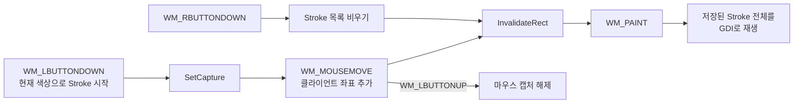

## Win API 그래픽, 입력 처리
목표
생성된 윈도우 내부에 GDI(Graphics Device Interface)를 사용하여 그래픽(도형, 선)을 출력하는 방법을 배웁니다. 또한, 키보드 및 마우스 입력을 나타내는 메시지를 처리하여 사용자와 상호작용하는 프로그램을 만들 수 있게 됩니다.

## 1. GDI와 DC: Windows의 그림판
Windows에서 화면에 무언가를 그리려면 "어디에" 그릴지, 그리고 "무엇으로" 그릴지에 대한 정보가 필요합니다.

`DC (Device Context):` "어디에" 그릴지에 대한 정보입니다. DC는 그림을 그릴 대상(윈도우, 프린터 등)에 대한 모든 정보를 담고 있는 데이터 구조체입니다. 우리는 이 DC에 대한 핸들(HDC)을 얻어와서 그리기 작업을 수행합니다. DC는 일종의 그림판 또는 캔버스라고 생각할 수 있습니다.

`GDI 객체`: "무엇으로" 그릴지에 대한 정보입니다. 선을 그을 때 사용할 **펜(HPEN)**이나, 도형의 내부를 채울 때 사용할 브러시(HBRUSH) 등이 GDI 객체에 해당합니다. 원하는 색상이나 스타일로 GDI 객체를 만든 뒤, DC에 선택(SelectObject)하여 사용하고, 사용이 끝나면 반드시 원래 객체로 되돌리고 생성한 객체를 삭제(DeleteObject)해야 합니다.

## 2. WM_PAINT: 그리기의 시작점
윈도우의 일부 또는 전체가 다시 그려져야 할 때, 운영체제는 해당 윈도우에 WM_PAINT 메시지를 보냅니다.

언제 발생하는가?:

`윈도우가 처음 생성될 때`

다른 윈도우에 `가려졌다가 다시 나타날 때`

윈도우 `크기가 변경될 때`

프로그래머가 `강제로 다시 그리라고 요청`할 때 (InvalidateRect 함수 사용)

어떻게 처리하는가?:
WM_PAINT 메시지 핸들러 안에서 BeginPaint 함수를 호출하여 HDC를 얻고, 그리기가 끝나면 EndPaint 함수를 호출하여 DC를 해제해야 합니다. 모든 그리기 코드는 이 BeginPaint와 EndPaint 사이에 위치하는 것이 정석입니다.
```c
case WM_PAINT:
    {
        PAINTSTRUCT ps;
        HDC hdc = BeginPaint(hWnd, &ps); // DC 얻기
        // ... 여기에 그리기 코드를 작성합니다 ...
        EndPaint(hWnd, &ps); // DC 해제
    }
    break;
```
## 3. 사용자 입력 메시지 처리
사용자가 마우스를 움직이거나 키보드를 누르면, 해당 이벤트에 대한 메시지가 윈도우 프로시저로 전달됩니다.

마우스 메시지:

`WM_LBUTTONDOWN:` 마우스 왼쪽 버튼을 눌렀을 때

`WM_MOUSEMOVE:` 마우스를 움직일 때

`WM_LBUTTONUP:` 마우스 왼쪽 버튼에서 손을 떼었을 때

`WM_RBUTTONDOWN:` 마우스 오른쪽 버튼을 눌렀을 때

마우스 메시지가 발생했을 때, 커서의 좌표는 lParam 인자에 담겨 전달됩니다. GET_X_LPARAM(lParam) 와 GET_Y_LPARAM(lParam) 매크로를 사용하면 x, y 좌표를 쉽게 추출할 수 있습니다.

키보드 메시지:

`WM_KEYDOWN:` 키를 눌렀을 때

`WM_KEYUP:` 키에서 손을 떼었을 때

`WM_KEYDOWN`의 `wParam`에는 가상 키 코드가 전달됩니다. 알파벳 키는 `'A'` 같은 대문자 코드 값을 사용하며, `VK_KEY_A`라는 상수는 없습니다. `TranslateMessage`가 문자 입력을 변환하면 텍스트 문자는 별도의 `WM_CHAR` 메시지로 전달됩니다.

## 4. 화면이 다시 그려져도 유지되는 그림

화면에 그린 픽셀은 프로그램의 그리기 상태를 저장해 주지 않습니다. 창이 가려졌다가 다시 나타나면 운영체제는 `WM_PAINT`를 보내므로, 그릴 내용은 별도로 보관하고 `WM_PAINT`에서 다시 그려야 합니다.

이 저장소의 [SimplePaint 예제](./Paint/SimplePaint.cpp)는 각 선의 색상과 마우스 좌표 목록을 `Stroke`로 보관합니다. 마우스 이동은 좌표를 추가한 뒤 `InvalidateRect`로 다시 그리기를 요청하고, `WM_PAINT`는 보관된 모든 선을 재생성합니다. 오른쪽 클릭은 선 목록을 비운 뒤 창을 무효화합니다. 드래그 중에는 마우스 캡처를 사용하므로 포인터가 창 밖으로 나가도 버튼을 놓을 때까지 입력을 이어받습니다.



좌표는 창의 클라이언트 영역 기준 픽셀 좌표입니다. 창 크기를 바꾸어도 점을 새 크기에 맞게 비례 변환하지 않으므로, 기존 선은 저장된 픽셀 위치에 남고 새 영역은 빈 상태로 나타날 수 있습니다. 또한 `strokes`는 프로세스 메모리에만 있으므로 프로그램을 종료하면 그림이 사라집니다. 이 예제의 “유지”는 창 가림·다시 그리기 동안의 보존이지, 파일 저장이나 재시작 후 보존을 뜻하지 않습니다.

**따라 하기**:
1. 예제를 빌드하고 드래그로 여러 색상의 선을 그립니다. 색상은 R/G/B 키로 선택하며, 새 선에만 적용됩니다.
2. 다른 창으로 그림판을 가린 뒤 다시 드러내거나 창 크기를 바꿉니다. 선이 보존되는지 확인합니다.
3. 오른쪽 클릭으로 모든 선을 지운 뒤 다시 그려 봅니다.
4. `WM_MOUSEMOVE`에서 좌표 추가 또는 무효화 요청을 잠시 주석 처리하고, 화면 출력과 저장된 상태가 어떻게 달라지는지 관찰합니다.
5. 창 크기를 크게 바꾸고 기존 선이 어떻게 배치되는지 확인합니다. `Stroke`가 화면에 그려진 결과가 아니라 클라이언트 좌표 목록임을 설명합니다.

**완료 확인**: 그리기 상태(`strokes`)와 화면 픽셀을 구분해 설명하고, `WM_PAINT`가 상태를 화면으로 복원하는 이유를 말할 수 있습니다. 이 예제의 수명 범위가 현재 프로세스 실행 중으로 제한됨을 구분합니다. GDI 펜은 선택 해제한 뒤 삭제해야 합니다.